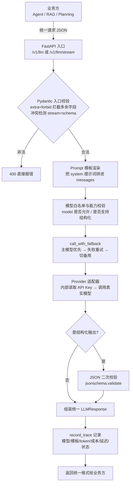

# 大模型 LLM‑Gateway 小白完整教程
### （音频讲解 ＋ gateway.py 源码逐段对照 ＋ 架构图）

> **一句话定位**：本文用大白话解释「大模型 Gateway（网关）是什么、为什么需要它、它怎么工作」，并把配套的 `gateway.py` 源码拆成 8 个模块逐一讲解，每个模块都配「音频讲解 + 代码 + 小白例子」，最后给完整可运行源码和测试命令。**不需要你有任何 AI 基础，跟着走就能看懂。**

> 参考来源：（大模型 Gateway 定义、价值、功能与实现逻辑）＋ `gateway.py` 源码 ＋ 三张架构示意图。

---

## 📌 目录

1. [什么是大模型 Gateway（大白话 + 音频定义）](#1-什么是大模型-gateway)
2. [为什么需要它（音频讲透核心价值）](#2-为什么需要它)
3. [六个核心要点总览（图 1）](#3-六个核心要点总览)
4. [整体架构与请求流转（图 2）](#4-整体架构与请求流转)
5. [模块逐段拆解：音频 + 代码 + 小白例子](#5-模块逐段拆解)
   - 5.1 请求协议 `Message` / `LLMRequest`
   - 5.2 统一出入口：入口校验 + 出口校验
   - 5.3 主备模型 `ModelConfig`
   - 5.4 Provider 适配器（图 3：统一请求 → 真实模型调用）
   - 5.5 非流式调用 + JSON 二次校验
   - 5.6 流式调用 + SSE
   - 5.7 Prompt 受控模板
   - 5.8 重试与备用模型 fallback
   - 5.9 调用追踪 Trace
   - 5.10 FastAPI 对外接口
6. [完整执行流程（非流式 / 流式两条时序）](#6-完整执行流程)
7. [完整 gateway.py 源码](#7-完整-gatewaypy-源码)
8. [启动 + 测试示例](#8-启动--测试示例)
9. [录音重点：坑点清单](#9-录音重点坑点清单)

---

## 1. 什么是大模型 Gateway

### 🎧 音频怎么讲的（定义）
> 录音原话：**Gateway 是统一模型调用的入口和出口，把模型调用的规则纳入一个统一的「可治理边界」**。
>
> 两种典型形态：
> - **独立的多模型管理软件**：单独部署一层，统一管理多家模型供应商；
> - **与模型绑定的内置 Gateway**：模型厂商自己带的一层网关（如虾皮等内置）。

### 🧒 大白话 + 小白例子
你可以把 Gateway 想成**公司前台的接待员**：

- 各个业务部门（Agent、RAG 检索、规划模块）就是**员工**；
- 外部的大模型厂商（DeepSeek、OpenAI、通义等）就是**外面的合作公司**；
- 员工不直接联系外面的合作公司，**全部找前台**；
- 前台统一：校验身份（验参）、传话（转格式）、出问题自动换一个合作公司（备用模型）、记录每笔开销（token/成本）、出事了查得到是谁的责任（trace）。

**好处**：员工（业务代码）不用知道外面有哪些公司、每家怎么联系、密钥是什么；换合作公司，前台改一下配置就行，员工完全无感。

### 它到底解决什么痛点（没网关 vs 有网关）
| 场景 | 没有网关 | 有网关 |
|---|---|---|
| 换模型 | 改 N 处业务代码 | 改网关一个配置 |
| API Key 管理 | 散落在各个服务，易泄露 | 只存在网关内部 |
| 模型挂了 | 业务报错，不会自动切换 | 自动切备用模型 |
| 各家 API 格式不同 | 每处业务自己适配 | 网关统一转格式 |
| 出问题排查 | 没有统一日志 | 全链路 trace 可查 |
| 结构化输出 | 各家自己处理 | 网关统一校验 |

---

## 2. 为什么需要它

> **金句 1**：「它的价值不是帮我们去转发请求，而是这里边呢，我们把模型调用的这个规则放在一个可治理的边界里边，这个才是最重要的。」
>
> 换句话说：Gateway 不是"多转发一次 HTTP"那么简单，**真正的价值是——把「允许用哪些模型、请求协议长什么样、用什么模板、重试几次、备用模型是谁、失败怎么返回」这些规则，全部集中到网关这一层，由工程师统一管控**。

### 为什么需要 Gateway（架构图）
![为什么需要 Gateway]

>讲了三点：**Agent / RAG / Planning 发出统一请求 → FastAPI LLM Gateway → 网关里做一堆治理**。

网关内部到底干了啥（下方 7 个功能模块）：
1. **Pydantic 入口校验** —— 请求进来先验格式，非法请求直接拦下；
2. **Prompt 模板渲染** —— 系统提示词统一由网关拼接；
3. **模型白名单与能力校验** —— 只能用网关允许的模型；
4. **OpenAI Compatible Provider** —— 统一把请求转成各家模型能懂的格式；
5. **重试与备用模型 fallback** —— 挂了自动重试、自动切换；
6. **Structured Output 出口校验** —— 返回的 JSON 再验一遍，防脏数据；
7. **Token / Cost / Latency Trace** —— 记录每次调用的用量、成本、延迟，方便排查。

---

## 3. 六个核心要点总览

### 图 1：搭建独立 LLM Gateway 的 6 个要点
![LLM Gateway 六大要点]

| 序号 | 要点 | 对应本文章节 |
|---|---|---|
| 1 | 说明 Agent 项目为什么需要独立的 LLM Gateway | §2 |
| 2 | 用 FastAPI 和 Pydantic 定义统一的模型调用入口与出口 | §5.1 / 5.2 |
| 3 | 用 Provider Adapter 隔离 OpenAI Compatible 模型的地址、认证和调用细节 | §5.4 |
| 4 | 在 Gateway 中统一处理 Prompt 模板、Structured Output 和 Streaming | §5.5 / 5.6 / 5.7 |
| 5 | 区分可重试错误与不可重试错误，实现有限重试和备用模型 fallback | §5.8 |
| 6 | 记录模型、Prompt 版本、Token、Cost、Latency 和调用状态 | §5.9 |

---

## 4. 整体架构与请求流转

### 一张图看懂整个 Gateway


### 模块清单（先混个眼熟）
| 模块 | 作用 | 代码位置 |
|---|---|---|
| `Message` / `LLMRequest` / `LLMResponse` | 统一出入口协议 | 24–77 行 |
| `ModelConfig` + `MODEL_CONFIGS` | 主备模型配置 | 108–133 行 |
| `OpenAICompatibleProvider` | 对接真实模型的适配器 | 178–247 行 |
| `render_prompt` / `PROMPT_TEMPLATES` | 受控 Prompt 模板 | 80–86 / 135–141 / 253–269 行 |
| `call_with_fallback` | 非流式主备+重试 | 323–374 行 |
| `stream_with_fallback` | 流式主备+SSE | 382–405 行 |
| `record_trace` / `CallTrace` | 调用追踪 | 89–105 / 288–316 行 |
| FastAPI 路由 | 对外三个接口 | 408–438 行 |

---

## 5. 模块逐段拆解

### 5.1 请求协议 `Message` / `LLMRequest`

> 网关请求协议有两个关键点：
> 1. **禁止夹带私货**：定义 `Message` 类时，用 `extra="forbid"` 禁止任何未声明的字段传进来，防止下游偷偷塞奇怪参数、污染网关内部逻辑；
> 2. **冲突提前拦截**：网关统一请求里包含模型、消息、是否流式、超时、prompt 等参数，**流式输出 和 结构化响应不能同时启用**，要在入口就报错，不要让问题流到后面。

#### 💻 代码
```python
class Message(BaseModel):
    model_config = ConfigDict(extra="forbid")   # 禁止额外字段！
    role: Literal["system", "user", "assistant"]
    content: str = Field(min_length=1, max_length=20_000)

class LLMRequest(BaseModel):
    model_config = ConfigDict(extra="forbid")
    model: str
    messages: list[Message]
    stream: bool = False
    response_schema: dict[str, Any] | None = None
    timeout_seconds: float = Field(default=30, gt=0, le=120)
    prompt: PromptSelection | None = None

    @model_validator(mode="after")
    def check_supported_combination(self) -> "LLMRequest":
        # 冲突校验：流式和结构化输出不能同时打开
        if self.stream and self.response_schema is not None:
            raise ValueError("stream 与 response_schema 不能同时使用")
        return self
```

#### 🧒 小白例子
- 业务方偷偷传一个 `hack_field: 123` → `extra="forbid"` 直接拒绝，请求进不来；
- 你同时传 `stream: true` 和 `response_schema: {...}` → 网关 400 报错：两者不能同时用。

---

### 5.2 统一出入口：入口校验 + 出口校验

#### 
> 接口开发规范：**响应出口要和输入保持统一的字段类型**，用 Pydantic 在入口、出口双向做校验，保证出入口稳定。先定好出入口字段与类型，再去做模型到供应商的映射。

#### 💻 代码（出口协议）
```python
class LLMResponse(BaseModel):
    model_config = ConfigDict(extra="forbid")
    request_id: str
    model: str
    content: str
    parsed: dict[str, Any] | list[Any] | None = None
    usage: Usage            # 统一输入/输出 token 统计
    latency_ms: int
    attempts: int
```

#### 🧒 小白理解
入口像**安检门**（验请求），出口像**质检台**（统一返回格式）。业务方无论内部调的是哪家模型，拿到手的永远是 `LLMResponse` 这个统一形状，调用代码不用改。

---

### 5.3 主备模型 `ModelConfig`

#### 
> 通过**环境变量**声明主模型 `general-primary` 和备用模型 `general-backup`，程序里不写死真实厂商模型名。这样部署时改环境变量就能换模型，不用改业务代码。**API Key 只存在网关内部**，业务 Agent 完全接触不到密钥，防泄露。

#### 💻 代码
```python
@dataclass(frozen=True)
class ModelConfig:
    provider_model: str      # 真实供应商模型名
    base_url: str            # 供应商地址
    api_key_env: str         # 从哪个环境变量读密钥
    supports_structured_output: bool
    structured_output_mode: Literal["json_schema", "json_object"] = "json_schema"

MODEL_CONFIGS = {
    "general-primary": ModelConfig(
        provider_model=os.getenv("PRIMARY_PROVIDER_MODEL", "deepseek-v4-flash"),
        base_url=os.getenv("PRIMARY_BASE_URL", "https://api.deepseek.com"),
        api_key_env="DEEPSEEK_API_KEY",
        supports_structured_output=True,
        structured_output_mode="json_object",
    ),
    "general-backup": ModelConfig(
        provider_model=os.getenv("BACKUP_PROVIDER_MODEL", "deepseek-chat"),
        base_url=os.getenv("BACKUP_BASE_URL", "https://api.deepseek.com"),
        api_key_env="DEEPSEEK_BACKUP_API_KEY",
        supports_structured_output=True,
        structured_output_mode="json_object",
    ),
}
```

#### 🧒 小白例子
业务请求里写 `model: "general-primary"`，网关自动映射到底层 `deepseek-v4-flash`；主模型挂了，网关自动切 `general-backup`（`deepseek-chat`）。**业务代码一行不用改**。密钥 `DEEPSEEK_API_KEY` 只在网关环境变量里，业务拿不到。

---

### 5.4 Provider 适配器（图 3：统一请求 → 真实模型调用）

#### 
> 1. 把对接各厂商 SDK 的活**全部封装进 Adapter（适配器）**，业务完全不碰 SDK、不碰密钥；
> 2. 统一请求转真实调用的逻辑：把 Pydantic 的 `Message` 转成普通字典，再调 OpenAI Compatible 的 Chat Completions；返回后**只提取完整文本和输入/输出 token**；
> 3. **SDK 的 completion 对象不离开 Provider**，网关其它部分只消费 `str` 和 `Usage`，因此不会和供应商的响应类型耦合（换模型供应商不用动网关主体）。

#### 📷 图 3 要点


> 数据流：`Pydantic Message → Provider → Chat Completions → str + Usage`

#### 💻 代码
```python
class OpenAICompatibleProvider:
    def create_client(self, config: ModelConfig) -> AsyncOpenAI:
        api_key = os.getenv(config.api_key_env)      # 网关内部读密钥
        if not api_key:
            raise GatewayError("gateway_misconfigured", "Gateway 模型凭据未配置", 503)
        return AsyncOpenAI(api_key=api_key, base_url=config.base_url, max_retries=0)

    async def complete(self, config, messages, timeout_seconds, response_schema):
        # 把网关统一 Message 转成 OpenAI 兼容的普通字典请求
        request_data = {
            "model": config.provider_model,
            "messages": [m.model_dump() for m in messages],  # Pydantic → dict
            "timeout": timeout_seconds,
        }
        # 结构化输出时给 response_format（省略细节，见源码）
        completion = await self.create_client(config).chat.completions.create(**request_data)
        content = completion.choices[0].message.content or ""
        usage = completion.usage
        # 只把 str 和 Usage 返回给网关，SDK 对象不离开这里
        return content, Usage(
            input_tokens=usage.prompt_tokens if usage else 0,
            output_tokens=usage.completion_tokens if usage else 0,
        )
```

#### 🧒 小白理解
Provider 就像一个**万能翻译官**：业务方只说中文（统一 Message），翻译官负责翻译成各家厂商的"外语"（各家 API 格式），并把结果翻译回统一格式。**业务方永远不用学任何一门外语**，换模型就是换翻译官，业务方无感。

---

### 5.5 非流式调用 + JSON 二次校验


> 网关要求模型输出 JSON 时，会把 `response_schema` 放进 `response_format` 的原生 JSON 模式。模型返回后，网关**再做一次二次校验**：JSON 格式、字段类型、必填项都要符合业务要求，校验通过才允许内容进入 Agent 循环。**在网关层就纠错，避免脏数据流到后面**。

#### 💻 代码（关键片段，`call_with_fallback` 内部）
```python
if request.response_schema is not None:
    try:
        parsed = json.loads(content)                      # 1. 必须是合法 JSON
        validate(instance=parsed, schema=request.response_schema)  # 2. 结构要符合 schema
    except json.JSONDecodeError as exc:
        raise GatewayError("invalid_json", "模型没有返回合法 JSON") from exc
    except JsonSchemaError as exc:
        raise GatewayError("schema_validation_failed", "模型结果不符合 response_schema") from exc
```

#### 🧒 小白例子
哪怕大模型拍胸脯说"我返回的是标准 JSON"，网关也**不信**，自己再验一遍格式、字段、必填项。不合格就报错，绝不让脏数据进入业务逻辑。

---

### 5.6 流式调用 + SSE

#### 
> 流式（streaming）处理：定义 stream 函数，**Provider 只提取增量信息**（delta），把供应商的 chunk 结构藏起来，由网关统一处理 SSE 流式输出。支持"首块输出前切换备用模型"的 stream-with-fallback；**首块输出后禁止切换备用模型**，避免内容混乱；流式调用不统计 usage（token）。

#### 💻 代码
```python
async def stream_with_fallback(request: LLMRequest) -> AsyncIterator[str]:
    emitted = False   # 是否已吐出第一个字符
    for model_name in dict.fromkeys([request.model, "general-backup"]):
        try:
            config = validate_model(model_name, None)
            async for delta in provider.stream(config, messages, request.timeout_seconds):
                emitted = True   # ⚠️ 已经输出内容！之后不能再切备用模型
                yield encode_sse({"type": "content.delta", "delta": delta})
            yield encode_sse({"type": "response.completed", "model": model_name})
            return
        except Exception as exc:
            if emitted or not is_retryable(exc):
                break            # 已输出内容 → 直接终止，不再尝试备用
    yield encode_sse({"type": "response.failed", "error": "upstream_stream_failed"})

def encode_sse(event: dict[str, Any]) -> str:
    # 编码成浏览器和 Agent 都能消费的 SSE 标准格式
    return f"data: {json.dumps(event, ensure_ascii=False)}\n\n"
```

#### 🧒 小白理解
流式就是**边收边发**（像打字机一个一个字吐出来）。关键点：一旦已经吐了第一个字，就**不能中途换供应商**——不然前面是 A 公司回答，后面突然变 B 公司，两段话拼起来就乱了。

---

### 5.7 Prompt 受控模板

#### 
> Gateway 管控的模板用 `name + version` 唯一标识，支持版本管理。**调用方只能传变量，不能修改模板正文**；模板不存在或变量缺失直接报错。把所有系统提示词收拢在网关统一管理，业务不能乱写 prompt。

#### 💻 代码
```python
PROMPT_TEMPLATES = {
    ("knowledge_decision", "v1"): PromptTemplate(
        name="knowledge_decision",
        version="v1",
        system_template="你是${product_name}的知识库决策器。资料不足时搜索，资料充分时结束回答。不得编造制度内容。",
    )
}

def render_prompt(selection: PromptSelection) -> Message:
    template = PROMPT_TEMPLATES.get((selection.name, selection.version))
    if template is None:
        raise GatewayError("unknown_prompt_template", "Prompt 模板不存在", 400)
    try:
        content = Template(template.system_template).substitute(selection.variables)
    except KeyError as exc:
        raise GatewayError("missing_prompt_variable", f"缺少 Prompt 变量: {exc.args[0]}", 400)
    return Message(role="system", content=content)
```

#### 🧒 小白例子
业务请求写：
```json
{
  "prompt": {
    "name": "knowledge_decision",
    "version": "v1",
    "variables": {"product_name": "企业OA系统"}
  }
}
```
网关自动渲染出 system 消息：`你是企业OA系统的知识库决策器。资料不足时搜索，资料充分时结束回答。不得编造制度内容。`
业务**只能填变量**，改不了模板正文，所有提示词版本统一在网关维护。

---

### 5.8 重试与备用模型 fallback

#### 
> 运行过程中要**先分清可重试与不可重试错误**：连接异常、超时、限流（RateLimit）这类属于可重试；认证失败这类属于不可重试。明确重试次数，重试次数累加这类通用逻辑可交给模型统一控制。

#### 💻 代码
```python
def is_retryable(exc: Exception) -> bool:
    # 连接错误 / 超时 / 限流 → 可重试；认证等其它错误 → 不可重试
    return isinstance(exc, (APIConnectionError, APITimeoutError, RateLimitError,
                            TimeoutError, ConnectionError))

async def call_with_fallback(request: LLMRequest) -> LLMResponse:
    # 主模型优先；对临时故障有限重试；仍失败则切能力等价的备用模型
    for model_name in dict.fromkeys([requested_model, "general-backup"]):
        ...
        for retry_number in range(2):          # 最多重试 1 次
            try:
                content, usage = await provider.complete(...)
                ...  # 二次 JSON 校验、组装响应
                return response
            except Exception as exc:
                last_error = exc
                if is_retryable(exc) and retry_number == 0:
                    await asyncio.sleep(0.1)   # 可重试 → 等一会重试
                    continue
                break                          # 不可重试 / 已重试过 → 放弃，走下一个模型
    raise GatewayError("model_unavailable", "主模型和备用模型均不可用")
```

#### 🧒 小白例子
主模型 `deepseek-v4-flash` 触发限流 429 → 属于可重试，重试一次；还失败 → 自动切备用 `deepseek-chat`。认证失败（key 错了）→ 不可重试，直接放弃，不浪费重试。

---

### 5.9 调用追踪 Trace

#### 🎧 音频讲解（录音 22:51 附近，金句 3）
> **金句 3**：「它的价值并不是说我们想去计算这个 token 用了多少，而是我们想要去计算一下，**为什么这件事情失败了**。」
>
> 记录内容：请求模型、实际返回模型、提示词名及版本、上下文长度（token）、成本、延迟、状态、错误码。**无论请求成功还是失败都要记录**。数据要**持久化落库**（可存关系型数据库、Redis、ClickHouse）。

#### 💻 代码
```python
class CallTrace(BaseModel):
    request_id: str
    timestamp: datetime
    requested_model: str        # 请求的模型
    actual_model: str | None    # 实际用的模型（可能是备用）
    prompt_name / prompt_version
    input_tokens / output_tokens
    cost_usd
    latency_ms
    attempts
    status: Literal["success", "failed"]
    error_code

def record_trace(...):
    trace = CallTrace(...)
    CALL_TRACES.append(trace)   # 生产环境应落库 Redis / ClickHouse
    logger.info("llm_call_trace=%s", trace.model_dump_json())
```

#### 🧒 小白理解
Trace 像**飞机黑匣子**：每次调用（成功失败都记）都有记录，出问题能查出"是谁、用了哪个模型、模板哪个版本、花了多少钱、卡在哪一步、报什么错"。**重点是排查为什么失败，不只是记账**。

---

### 5.10 FastAPI 对外接口

####
> 业务完成后，以 `uvicorn gateway:app` 启动，用 FastAPI，监听 **8000 端口**。对外暴露接口：一是 POST 的（普通 / 流式）chat completion 接口，二是 `/v1/traces` 的 trace 整体查询观测接口。

#### 💻 代码
```python
app = FastAPI(title="Agent LLM Gateway", version="0.0.1")

@app.post("/v1/llm", response_model=LLMResponse)          # 普通非流式调用
async def create_llm_response(request: LLMRequest) -> LLMResponse:
    if request.stream:
        raise HTTPException(400, detail={"code": "use_stream_endpoint", ...})
    try:
        return await call_with_fallback(request)
    except GatewayError as exc:
        raise HTTPException(exc.status_code, detail={"code": exc.code, "message": exc.message})

@app.post("/v1/llm/stream")                                # 流式 SSE 输出
async def create_stream(request: LLMRequest) -> StreamingResponse:
    if request.response_schema is not None:
        raise HTTPException(400, detail={"code": "unsupported_combination", ...})
    ...
    return StreamingResponse(stream_with_fallback(request), media_type="text/event-stream")

@app.get("/v1/traces", response_model=list[CallTrace])     # 查询调用审计记录
async def list_traces() -> list[CallTrace]:
    return CALL_TRACES
```

#### 🧒 小白理解
对外就 3 个口子：普通调用（一次性返回）、流式调用（边收边发）、查 trace（看历史记录）。业务方只认这 3 个口子就行。

---

## 6. 完整执行流程

### 时序 A：非流式普通请求
```
1. 业务方 POST /v1/llm 发 JSON 请求
2. FastAPI + Pydantic 解析 LLMRequest
   ├─ extra="forbid" 拦截多余字段
   └─ model_validator 校验 stream 和 schema 冲突
3. build_messages()：携带 prompt 则 render_prompt 拼 system 消息
4. validate_model()：检查模型是否在白名单、是否支持结构化输出
5. call_with_fallback()
   ├─ 主模型 → 备用模型 两级循环
   ├─ 内部再按 retry_number 有限重试（可重试才重试）
   ├─ provider.complete()：网关内部读 API Key，调真实模型
   ├─ 有 response_schema → json.loads + jsonschema.validate 二次校验
   └─ 组装统一 LLMResponse
6. record_trace() 记录成功日志
7. 返回统一 JSON 给调用方
```
> 若主备都失败：记录 status=failed 的 trace，抛 `model_unavailable`，返回 HTTP 错误。

### 时序 B：流式请求
```
1. POST /v1/llm/stream，校验禁止传 response_schema
2. build_messages() 拼 prompt 模板消息
3. stream_with_fallback()
   ├─ 优先主模型，provider.stream() 逐块取增量
   ├─ 每收一块 delta → emitted=True → 编码 SSE 事件 data:{...} 返回
   ├─ ⚠️ 一旦 emitted=True，之后报错也不再切备用模型
   ├─ 全部完成 → 发 response.completed 事件
   └─ trace 记录（流式 usage 写 0）
```

---

## 7. 完整 gateway.py 源码

> 可直接保存为 `gateway.py` 运行。依赖安装：
> `pip install fastapi uvicorn pydantic "openai>=1.0" jsonschema`

```python
import asyncio
import json
import logging
import os
import time
from collections.abc import AsyncIterator
from dataclasses import dataclass
from datetime import datetime, timezone
from string import Template
from typing import Any, Literal, Protocol
from uuid import uuid4

from fastapi import FastAPI, HTTPException
from fastapi.responses import StreamingResponse
from jsonschema import ValidationError as JsonSchemaError
from jsonschema import validate
from openai import APIConnectionError, APITimeoutError, AsyncOpenAI, RateLimitError
from pydantic import BaseModel, ConfigDict, Field, model_validator

logger = logging.getLogger("llm_gateway")


class Message(BaseModel):
    # 定义跨模型通用的单条对话消息，隔离供应商消息格式差异。
    model_config = ConfigDict(extra="forbid")
    role: Literal["system", "user", "assistant"]
    content: str = Field(min_length=1, max_length=20_000)


class PromptSelection(BaseModel):
    # 只允许调用方选择受控模板及变量，不能提交或覆盖模板正文。
    model_config = ConfigDict(extra="forbid")
    name: str = Field(min_length=1, max_length=100)
    version: str = Field(min_length=1, max_length=50)
    variables: dict[str, str] = Field(default_factory=dict)


class LLMRequest(BaseModel):
    # 统一 Gateway 请求协议，并在 HTTP 入口拦截不合法组合和字段。
    model_config = ConfigDict(extra="forbid")
    model: str = Field(min_length=1, max_length=100)
    messages: list[Message] = Field(min_length=1, max_length=100)
    stream: bool = False
    response_schema: dict[str, Any] | None = None
    timeout_seconds: float = Field(default=30, gt=0, le=120)
    prompt: PromptSelection | None = None

    @model_validator(mode="after")
    def check_supported_combination(self) -> "LLMRequest":
        if self.stream and self.response_schema is not None:
            raise ValueError("stream 与 response_schema 不能同时使用")
        return self


class Usage(BaseModel):
    # 统一输入与输出 Token 统计口径，用于成本和用量治理。
    model_config = ConfigDict(extra="forbid")
    input_tokens: int = Field(ge=0)
    output_tokens: int = Field(ge=0)


class LLMResponse(BaseModel):
    # 统一模型调用结果，并作为 FastAPI 响应出口的 Pydantic 校验契约。
    model_config = ConfigDict(extra="forbid")
    request_id: str
    model: str
    content: str
    parsed: dict[str, Any] | list[Any] | None = None
    usage: Usage
    latency_ms: int = Field(ge=0)
    attempts: int = Field(ge=1)


class PromptTemplate(BaseModel):
    # 表示由 Gateway 发布和版本化管理的系统 Prompt 模板资产。
    model_config = ConfigDict(extra="forbid")
    name: str
    version: str
    system_template: str


class CallTrace(BaseModel):
    # 保存单次调用的模型、Token、成本、延迟与状态，默认不记录文本内容。
    model_config = ConfigDict(extra="forbid")
    request_id: str
    timestamp: datetime
    requested_model: str
    actual_model: str | None = None
    prompt_name: str | None = None
    prompt_version: str | None = None
    input_tokens: int = Field(ge=0)
    output_tokens: int = Field(ge=0)
    cost_usd: float = Field(ge=0)
    latency_ms: int = Field(ge=0)
    attempts: int = Field(ge=0)
    status: Literal["success", "failed"]
    error_code: str | None = None


@dataclass(frozen=True)
class ModelConfig:
    # 将平台模型名映射为供应商模型、地址、密钥与能力配置。
    provider_model: str
    base_url: str
    api_key_env: str
    supports_structured_output: bool
    structured_output_mode: Literal["json_schema", "json_object"] = "json_schema"


MODEL_CONFIGS = {
    "general-primary": ModelConfig(
        provider_model=os.getenv("PRIMARY_PROVIDER_MODEL", "deepseek-v4-flash"),
        base_url=os.getenv("PRIMARY_BASE_URL", "https://api.deepseek.com"),
        api_key_env="DEEPSEEK_API_KEY",
        supports_structured_output=True,
        structured_output_mode="json_object",
    ),
    "general-backup": ModelConfig(
        provider_model=os.getenv("BACKUP_PROVIDER_MODEL", "deepseek-chat"),
        base_url=os.getenv("BACKUP_BASE_URL", "https://api.deepseek.com"),
        api_key_env="DEEPSEEK_BACKUP_API_KEY",
        supports_structured_output=True,
        structured_output_mode="json_object",
    ),
}

PROMPT_TEMPLATES = {
    ("knowledge_decision", "v1"): PromptTemplate(
        name="knowledge_decision",
        version="v1",
        system_template="你是${product_name}的知识库决策器。资料不足时搜索，资料充分时结束回答。不得编造制度内容。",
    )
}

PRICE_PER_MILLION = {
    "general-primary": {"input": 1.0, "output": 4.0},
    "general-backup": {"input": 0.8, "output": 3.2},
}

CALL_TRACES: list[CallTrace] = []


class GatewayError(Exception):
    # 将内部错误标准化为可安全暴露给调用方的稳定错误码和 HTTP 状态。
    def __init__(self, code: str, message: str, status_code: int = 502) -> None:
        self.code = code
        self.message = message
        self.status_code = status_code
        super().__init__(message)


class Provider(Protocol):
    # 规定供应商 Adapter 的统一接口，业务流程不依赖具体 SDK。
    async def complete(self, config: ModelConfig, messages: list[Message],
                       timeout_seconds: float,
                       response_schema: dict[str, Any] | None) -> tuple[str, Usage]: ...
    async def stream(self, config: ModelConfig, messages: list[Message],
                     timeout_seconds: float) -> AsyncIterator[str]: ...


class OpenAICompatibleProvider:
    # 实现 OpenAI Compatible Adapter，集中处理供应商协议与认证细节。
    # 将 API Key 保留在 Gateway 内，业务 Agent 无需接触供应商密钥。
    def create_client(self, config: ModelConfig) -> AsyncOpenAI:
        api_key = os.getenv(config.api_key_env)
        if not api_key:
            raise GatewayError("gateway_misconfigured", "Gateway 模型凭据未配置", 503)
        return AsyncOpenAI(api_key=api_key, base_url=config.base_url, max_retries=0)

    async def complete(self, config: ModelConfig, messages: list[Message],
                       timeout_seconds: float,
                       response_schema: dict[str, Any] | None) -> tuple[str, Usage]:
        # 将统一请求转换为 OpenAI Compatible 调用，隔离厂商协议差异。
        request_data: dict[str, Any] = {
            "model": config.provider_model,
            "messages": [message.model_dump() for message in messages],
            "timeout": timeout_seconds,
        }
        if response_schema is not None:
            if config.structured_output_mode == "json_schema":
                request_data["response_format"] = {
                    "type": "json_schema",
                    "json_schema": {"name": "agent_response", "strict": True,
                                    "schema": response_schema},
                }
            else:
                request_data["response_format"] = {"type": "json_object"}
                request_data["messages"] = [
                    {"role": "system",
                     "content": ("只返回一个合法 JSON 对象，必须严格符合下列 JSON Schema，"
                                 "不要返回 Markdown 或额外文字："
                                 f"{json.dumps(response_schema, ensure_ascii=False)}")},
                    *request_data["messages"],
                ]
        completion = await self.create_client(config).chat.completions.create(**request_data)
        content = completion.choices[0].message.content or ""
        usage = completion.usage
        return content, Usage(
            input_tokens=usage.prompt_tokens if usage else 0,
            output_tokens=usage.completion_tokens if usage else 0,
        )

    async def stream(self, config: ModelConfig, messages: list[Message],
                     timeout_seconds: float) -> AsyncIterator[str]:
        # 逐块读取上游响应，为 Gateway 的实时流式代理提供标准增量文本。
        response = await self.create_client(config).chat.completions.create(
            model=config.provider_model,
            messages=[message.model_dump() for message in messages],
            stream=True,
            timeout=timeout_seconds,
        )
        async for chunk in response:
            choice = chunk.choices[0] if chunk.choices else None
            if choice and choice.delta.content:
                yield choice.delta.content


provider: Provider = OpenAICompatibleProvider()


def render_prompt(selection: PromptSelection) -> Message:
    # 从受控模板库渲染系统提示词，调用方只能传版本和变量。
    template = PROMPT_TEMPLATES.get((selection.name, selection.version))
    if template is None:
        raise GatewayError("unknown_prompt_template", "Prompt 模板不存在", 400)
    try:
        content = Template(template.system_template).substitute(selection.variables)
    except KeyError as exc:
        raise GatewayError("missing_prompt_variable", f"缺少 Prompt 变量: {exc.args[0]}", 400) from exc
    return Message(role="system", content=content)


def build_messages(request: LLMRequest) -> list[Message]:
    # 将模板系统消息统一注入调用上下文，避免 Prompt 分散在各个 Agent 中。
    if request.prompt is None:
        return request.messages
    return [render_prompt(request.prompt), *request.messages]


def validate_model(model: str, response_schema: dict[str, Any] | None) -> ModelConfig:
    # 校验模型白名单和结构化能力，阻止不等价的 fallback。
    config = MODEL_CONFIGS.get(model)
    if config is None:
        raise GatewayError("unknown_model", "模型不在 Gateway 允许列表中", 400)
    if response_schema is not None and not config.supports_structured_output:
        raise GatewayError("structured_output_unsupported", "模型不支持 Structured Output", 400)
    return config


def calculate_cost(model: str, usage: Usage) -> float:
    # 按实际模型和输入输出 Token 计算本次调用成本。
    price = PRICE_PER_MILLION[model]
    return (usage.input_tokens * price["input"] + usage.output_tokens * price["output"]) / 1_000_000


def record_trace(request_id, requested_model, actual_model, prompt, usage,
                 latency_ms, attempts, status, error_code=None) -> None:
    # 留存调用元数据，支持成本、延迟、模型和模板版本治理。
    trace = CallTrace(
        request_id=request_id,
        timestamp=datetime.now(timezone.utc),
        requested_model=requested_model,
        actual_model=actual_model,
        prompt_name=prompt.name if prompt else None,
        prompt_version=prompt.version if prompt else None,
        input_tokens=usage.input_tokens,
        output_tokens=usage.output_tokens,
        cost_usd=calculate_cost(actual_model, usage) if actual_model else 0,
        latency_ms=latency_ms,
        attempts=attempts,
        status=status,
        error_code=error_code,
    )
    CALL_TRACES.append(trace)
    logger.info("llm_call_trace=%s", trace.model_dump_json())


def is_retryable(exc: Exception) -> bool:
    return isinstance(exc, (APIConnectionError, APITimeoutError, RateLimitError,
                            TimeoutError, ConnectionError))


async def call_with_fallback(request: LLMRequest) -> LLMResponse:
    # 对临时故障有限重试，并在主模型不可用时切换能力等价的备用模型。
    requested_model = request.model
    request_id = str(uuid4())
    started = time.perf_counter()
    attempts = 0
    last_error: Exception | None = None
    messages = build_messages(request)
    for model_name in dict.fromkeys([requested_model, "general-backup"]):
        try:
            config = validate_model(model_name, request.response_schema)
        except GatewayError as exc:
            if model_name == requested_model:
                raise exc
            last_error = exc
            continue
        for retry_number in range(2):
            attempts += 1
            try:
                content, usage = await provider.complete(
                    config, messages, request.timeout_seconds, request.response_schema)
                parsed: dict[str, Any] | list[Any] | None = None
                if request.response_schema is not None:
                    try:
                        parsed = json.loads(content)
                        validate(instance=parsed, schema=request.response_schema)
                    except json.JSONDecodeError as exc:
                        raise GatewayError("invalid_json", "模型没有返回合法 JSON") from exc
                    except JsonSchemaError as exc:
                        raise GatewayError("schema_validation_failed",
                                           "模型结果不符合 response_schema") from exc
                response = LLMResponse(
                    request_id=request_id,
                    model=model_name,
                    content=content,
                    parsed=parsed,
                    usage=usage,
                    latency_ms=int((time.perf_counter() - started) * 1000),
                    attempts=attempts,
                )
                record_trace(request_id, requested_model, model_name, request.prompt,
                             usage, response.latency_ms, attempts, "success")
                return response
            except GatewayError:
                raise
            except Exception as exc:
                last_error = exc
                if is_retryable(exc) and retry_number == 0:
                    await asyncio.sleep(0.1)
                    continue
                break
    latency_ms = int((time.perf_counter() - started) * 1000)
    record_trace(request_id, requested_model, None, request.prompt,
                 Usage(input_tokens=0, output_tokens=0), latency_ms, attempts,
                 "failed", "model_unavailable")
    raise GatewayError("model_unavailable", "主模型和备用模型均不可用") from last_error


def encode_sse(event: dict[str, Any]) -> str:
    # 将统一事件编码为浏览器和 Agent 都可消费的 SSE 格式。
    return f"data: {json.dumps(event, ensure_ascii=False)}\n\n"


async def stream_with_fallback(request: LLMRequest) -> AsyncIterator[str]:
    # 上游首块前可切备用模型；首块后仅发送流内错误，避免文本重复。
    messages = build_messages(request)
    started = time.perf_counter()
    attempts = 0
    emitted = False
    last_error: Exception | None = None
    for model_name in dict.fromkeys([request.model, "general-backup"]):
        try:
            config = validate_model(model_name, None)
            attempts += 1
            async for delta in provider.stream(config, messages, request.timeout_seconds):
                emitted = True
                yield encode_sse({"type": "content.delta", "delta": delta})
            record_trace(str(uuid4()), request.model, model_name, request.prompt,
                         Usage(input_tokens=0, output_tokens=0),
                         int((time.perf_counter() - started) * 1000), attempts, "success")
            yield encode_sse({"type": "response.completed", "model": model_name})
            return
        except Exception as exc:
            last_error = exc
            if emitted or not is_retryable(exc):
                break
    logger.exception("upstream stream failed", exc_info=last_error)
    record_trace(str(uuid4()), request.model, None, request.prompt,
                 Usage(input_tokens=0, output_tokens=0),
                 int((time.perf_counter() - started) * 1000), attempts,
                 "failed", "upstream_stream_failed")
    yield encode_sse({"type": "response.failed", "error": "upstream_stream_failed"})


app = FastAPI(title="Agent LLM Gateway", version="0.0.1")


@app.post("/v1/llm", response_model=LLMResponse)
async def create_llm_response(request: LLMRequest) -> LLMResponse:
    # FastAPI 在入口校验请求、在 response_model 校验统一响应出口。
    if request.stream:
        raise HTTPException(status_code=400, detail={"code": "use_stream_endpoint",
                                                     "message": "流式请求请使用 /v1/llm/stream"})
    try:
        return await call_with_fallback(request)
    except GatewayError as exc:
        raise HTTPException(status_code=exc.status_code,
                            detail={"code": exc.code, "message": exc.message}) from exc


@app.post("/v1/llm/stream")
async def create_stream(request: LLMRequest) -> StreamingResponse:
    # 提供独立流式入口，明确禁止与 Structured Output 混用。
    if request.response_schema is not None:
        raise HTTPException(status_code=400, detail={"code": "unsupported_combination",
                                                     "message": "流式输出不支持 response_schema"})
    try:
        validate_model(request.model, None)
        build_messages(request)
    except GatewayError as exc:
        raise HTTPException(status_code=exc.status_code,
                            detail={"code": exc.code, "message": exc.message}) from exc
    return StreamingResponse(stream_with_fallback(request), media_type="text/event-stream")


@app.get("/v1/traces", response_model=list[CallTrace])
async def list_traces() -> list[CallTrace]:
    # 暴露调用审计记录，供成本分析与故障排查使用。
    return CALL_TRACES
```

---

## 8. 启动 + 测试示例

### 启动网关
```bash
# 安装依赖
pip install fastapi uvicorn pydantic "openai>=1.0" jsonschema

# 配置环境变量（换成你自己的真实 key）
export DEEPSEEK_API_KEY="sk-xxx"
export DEEPSEEK_BACKUP_API_KEY="sk-yyy"

# 启动（监听 8000 端口）
uvicorn gateway:app --host 0.0.0.0 --port 8000
```

### ① 普通非流式调用
```bash
curl -X POST http://127.0.0.1:8000/v1/llm \
  -H "Content-Type: application/json" \
  -d '{
    "model": "general-primary",
    "messages": [{"role": "user", "content": "简单介绍一下大模型 gateway"}],
    "stream": false,
    "timeout_seconds": 30
  }'
```

### ② 使用受控 prompt 模板调用
```bash
curl -X POST http://127.0.0.1:8000/v1/llm \
  -H "Content-Type: application/json" \
  -d '{
    "model": "general-primary",
    "messages": [{"role": "user", "content": "查询一下知识库里的请假制度"}],
    "prompt": {
      "name": "knowledge_decision",
      "version": "v1",
      "variables": {"product_name": "企业OA系统"}
    }
  }'
```

### ③ 结构化输出（response_schema）
```bash
curl -X POST http://127.0.0.1:8000/v1/llm \
  -H "Content-Type: application/json" \
  -d '{
    "model": "general-primary",
    "messages": [{"role": "user", "content": "把这句话转成结构化结果"}],
    "response_schema": {
      "type": "object",
      "properties": {"summary": {"type": "string"}, "label": {"type": "string"}},
      "required": ["summary", "label"]
    }
  }'
```

### ④ 流式调用（SSE）
```bash
curl -N -X POST http://127.0.0.1:8000/v1/llm/stream \
  -H "Content-Type: application/json" \
  -d '{
    "model": "general-primary",
    "messages": [{"role": "user", "content": "写一段三行的小诗"}],
    "stream": true
  }'
```

### ⑤ 查询 trace 审计记录
```bash
curl http://127.0.0.1:8000/v1/traces
```

---

## 9. 重点：坑点清单

| # | 坑点 | 说明 |
|---|---|---|
| 1 | ❌ 别把 Gateway 当纯代理转发 | 核心价值是**把模型调用规则放进可治理边界**，不是多转发一次 HTTP |
| 2 | ❌ 别让业务代码持有各厂商 API Key | 密钥全部放网关环境变量，业务 Agent 拿不到，防泄露 |
| 3 | ❌ 别同时开 stream 和 response_schema | 网关入口用 `model_validator` 直接拦截 |
| 4 | ❌ 流式已吐出第一个字符后别切备用模型 | 否则两段回答拼接混乱，用 `emitted=True` 标记后直接终止 |
| 5 | ❌ 别信任模型返回的 JSON | 网关层必须做 jsonschema 二次校验，不合格就报错 |
| 6 | ✅ 成功失败都要记 trace | **trace 的目的是排查为什么失败**，不只是算 token 账单 |
| 7 | ✅ Prompt 模板统一收归网关 | 调用方只传变量，不允许改模板正文 |
| 8 | ✅ 区分可重试/不可重试错误 | 认证错误不重试；超时、连接失败、限流可有限次数重试 |

> **拓展方向（录音提到）**：演示代码里 `CALL_TRACES` 用的是内存列表，只适合演示；**生产环境要把 trace 持久化落库**（Redis / ClickHouse / 关系型数据库），才能真正支撑故障排查与成本治理。

---


