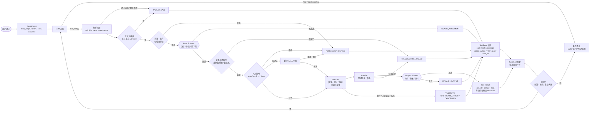

# 大模型工具调用流程：从三个 Schema 到完整工具协议

> **课程**：大模型工具调用流程讲解  
> **主题**：工具协议的三个 Schema（Input / Output / Error）、错误分类与恢复策略、把 Schema 与真实业务函数装配成工具、让大模型组合出可运行的 Runtime

---

## 0. 本节要解决的问题：承接上一节的结论

上一节（工具定义规范）的收尾结论是：

> **工具定义不是函数注释，而是跨越模型、Runtime 和业务系统的执行协议。**  
> 工程师必须确定工具粒度、用途边界、数据结构、权限、风险和失败策略；模型只能在这份协议内提出调用。  
> 模型可以生成字段，却不能替业务系统确定必填条件、跨字段关系、稳定返回值和错误恢复语义。  
> **所以下一步不是继续增加工具描述，而是把输入、输出和错误写成真正可以校验的类型。**

这一节就是那句「下一步」的落地：**把「描述」换成「类型」，让协议可以被机器校验。**

一句话概括全节：

> 工具协议 = Input Schema + Output Schema + Error Schema。三者分别卡在 Agent Loop 的三个接缝上，缺任何一份，Loop 就只能靠解析自然语言硬撑。

---

## 1. 工具协议的三个组成部分

| Schema | 回答的问题 | 在 Loop 中的位置 | 失守的后果 |
|---|---|---|---|
| **Input Schema** | 调用需要哪些参数？参数合法吗？ | Tool Call 与 Handler **之间** | 拿脏参数去打真实接口，报错在运行时才暴露 |
| **Output Schema** | 成功之后返回什么事实？ | Handler 与 Tool Result **之间** | 下游要猜字段，格式漂移会污染后续推理 |
| **Error Schema** | 失败后属于哪一类？能不能恢复？ | 失败与下一轮决策 **之间** | 模型无从判断「重试 / 换路 / 停下来找人」 |

**核心判断**：这三份不是三个独立的校验函数，而是三道**闸门（gate）**，分别守在三个位置。位置错了，校验就白做。

---

## 2. Input Schema：把「用错」拦在调用之前

### 2.1 代码原文

```ts
# 验收模型的参数是否符合要求
import { Hono } from 'hono'
import { z } from 'zod'
// 桥接hono和zod
import { zValidator } from '@hono/zod-validator'
// 创建 Hono 实例，相当于启动一个服务实例，后续在上面注册路由。
const app = new Hono()


const OrderStatus = z.enum(['pending', 'paid', 'shipped', 'cancelled'])
// .optional()是可选，不传就是undefined
const SearchOrdersInputSchema = z
  .object({
    status: OrderStatus.optional(), // 限定status只能是这四种字段
    created_from: z.coerce.date().optional(), // 自动把合法的日期转换成js Date对象 ,非法失败
    limit: z.number().int().min(1).max(50).default(10), // 必须是整数 最小值 1，最大值 50  默认10
  })
  .strict() // ✅ 等价 pydantic extra="forbid"
  .refine( // `.refine` 是 Zod 的自定义对象级校验 
    (data) => {
      // - 回调在所有字段校验通过之后执行 - 逻辑：不能 status 和 created_from 同时为空 - 返回 `false` → 抛出校验错误
      return !(data.status === undefined && data.created_from === undefined)
    },
    {
      message: 'status 与 created_from 至少提供一个',
      path: [],// 代表这个错误不属于某一个字段，是整个对象层面的错误
    }
  )

// 路由示例：GET 查询订单，query 参数校验
/*
zValidator是中间件
- 第一个参数 `'query'`：代表校验**url query 参数**（`?a=1&b=2`）
如果是 POST body，改成 `'json'`
- 校验失败：Hono 自动返回 `400 Bad Request`，带上 Zod 的 error 信息，不用自己写 try/catch*/

app.get( // 注册 GET 接口
  '/orders/search',
  zValidator('query', SearchOrdersInputSchema),
  (c) => {
    const input = c.req.valid('query')
    return c.json({ // 返回 JSON 响应
      ok: true,
      input,
    })
  }
)

export default app

```

> Zod 默认行为：**多余字段直接忽略**，等价 pydantic `extra="ignore"`。  
`StrictModel` 是课程里自定义的严格基类（等价于禁止多余字段的 `.strict()`），模型多塞一个字段就直接报错，而不是被静默忽略。

### 2.2 四个设计要点

1. **枚举不给自由发挥空间：status 使用 `z.enum()` 白名单，而不是 `z.string()`**
不放开自由字符串，只允许指定的四个值；非法状态在校验阶段直接拦截，避免非法业务状态流入后续逻辑。
2. **数量做四重约束：`limit: z.number().int().min(1).max(50).default(10)`**
   - 类型约束：必须是整数
   - 下界 min (1)：禁止 0、负数
   - 上界 max (50)：防止一次性拉取大量数据、全表扫描
   - 默认值 default (10)：不传参数时自动填充，接口可正常运行
3. **日期用 `z.coerce.date()` 而不是原始 string**
自动把传入的日期字符串转成 Date 对象，合法性校验交给 Zod，不用自己在业务代码手写 try/catch 判断日期是否合法；提前拦截非法日期格式。
4. **跨字段关系必须显式写出来：`.refine()` 表达「status 与 created_from 至少提供一个」**
属于对象级业务规则，单个字段校验无法表达；这个校验拦截不带筛选条件的裸查，避免无过滤条件查询整张表。

### 2.3 讲者反复强调的两个观点

- **校验时机**：校验必须在「工具送入下一轮模型之前」完成。不是在 handler 里补救，而是在模型还没看见结果之前挡住。
- **不要纠结语法**：「具体的校验规则、这些 是ts还是Python 的功能，大模型写的会比我们自己写的更好。」工程师的职责是**说清约束**。

> 换句话说：Input Schema 的价值不在代码多漂亮，而在**约束是否被写成了可执行的形式**。写在 description 里的「limit 不要超过 50」，模型会忘；写成 `le=50`，模型忘不了。

---

## 3. Output Schema：把「成功」固定成可预期的事实

`search_orders` 的返回值**只允许**包含两样东西：

- 订单编号
- 搜索到的总条数

**只要返回了其他字段，就判定为业务函数异常，直接报错。**

为什么这么苛刻：

- Output Schema 的作用是**「固定成功事实」**——成功路径上不允许多说、也不允许少说。
- 下游（下一轮模型、上层编排、日志与评测）依赖这个稳定结构；一旦 handler「顺手多返回了几个字段」，格式就开始漂移，模型接下来的推理也会被多余信息带偏。
- 反过来，缺字段同样危险：`INVALID_OUTPUT` 的注释明确写了**「不要猜测缺少的字段」**——猜出来的成功事实是假事实。

---

## 4. Error Schema：把失败变成「可决策的信号」

### 4.1 代码原文

```ts
# 统一表达错误的方式
import { z } from "zod"

/**
 * 工具错误码枚举白名单
 * INVALID_ARGUMENT  : 模型修正参数之后再次调用
 * TOOL_NOT_FOUND    : 工具不存在
 * PERMISSION_DENIED : 不能重试统一个调用，应该提示用户切换身份并停止执行
 * APPROVAL_REQUIRED : 需要用户审批
 * TIMEOUT           : 超时
 * UPSTREAM_ERROR    : 上游错误，只有满足幂等条件的时候，runtime 才能有限的重试
 * INVALID_OUTPUT    : 业务工具违反的预先定义的返回协议，应记录工程故障，停止执行，不要猜测缺少的字段
 */
const ToolErrorCode = z.enum([
  "INVALID_ARGUMENT",
  "TOOL_NOT_FOUND",
  "PERMISSION_DENIED",
  "APPROVAL_REQUIRED",
  "TIMEOUT",
  "UPSTREAM_ERROR",
  "INVALID_OUTPUT",
])

/**
 * ToolError 工具错误结构
 * 对齐 Python Pydantic StrictModel，.strict() 等价 extra="forbid"，禁止额外字段
 */
export const ToolErrorSchema = z.object({
  // 错误码，限定固定枚举，不允许自定义字符串
  code: ToolErrorCode,
  // 可读错误描述信息
  message: z.string(),
  // 是否可重试，默认 false
  retryable: z.boolean().default(false),
}).strict()

// 导出 TS 类型，用于类型标注
export type ToolError = z.infer<typeof ToolErrorSchema>

```

### 4.2 错误分类与处理策略（全套表）

| code | 含义 | 处理策略 | 重试？ | 谁负责 |
|---|---|---|---|---|
| `INVALID_ARGUMENT` | 参数无效 | **本次不真正调用工具**，直接告诉模型参数错在哪，让它重新收集参数后再调 | ❌（模型自己会再调一次） | 模型 + Input Schema |
| `TOOL_NOT_FOUND` | 工具不存在 | 运行时白名单变更 / 工具下线导致不可用；调用前先检查工具是否在可用范围内 | ❌ | Runtime |
| `PERMISSION_DENIED` | 权限不足 | 统一调用不能重试，**提示用户切换身份并停止执行** | ❌ | Runtime |
| `APPROVAL_REQUIRED` | 需用户审批 | 挂起，等审批通过后继续 | 暂停 | 人 |
| `TIMEOUT` | 超时 | 满足幂等条件时**有限次数**重试，间隔逐步拉大 | ✅ 有限 | Runtime |
| `UPSTREAM_ERROR` | 上游错误 | 同上：只有满足幂等条件，runtime 才能有限重试 | ✅ 有限 | Runtime |
| `INVALID_OUTPUT` | 违反返回协议 | **记录工程故障、停止执行、人工介入**，不要猜缺失字段 | ❌ | 人 + 监控 |

`retryable: bool = False` 这个默认值很关键：**默认不可重试**。只有明确判定幂等、明确属于超时/上游抖动，才把它置为 True。

### 4.3 重试的两条铁律

用「接口超时」举例，指出重试必须同时管住两件事：

1. **次数**：设上限。无上限重试等于把故障放大。
2. **间隔 + 幂等**：「要借助幂等方式不断拉大重试间隔，避免同一时间集中重试引发雪崩。」

> 「我们同一时间来去重试，这样容易产生一些雪崩。」

这正是 `TIMEOUT` / `UPSTREAM_ERROR` 后面都挂着「满足幂等条件」的原因——**不幂等的操作重试 = 重复下单、重复扣款**。

### 4.4 为什么错误必须「统一表达」

- 错误码来自 Codex 的实践，把「失败」变成机器可分类的枚举，而不是一段自由文本。
- 一旦统一，**由谁处理是确定的**：模型改参数、Runtime 做有限重试、或者停下来找人。三者分工清楚，Loop 才能自动推进而不死循环。
- 如果只是抛一个字符串异常，模型只能靠语义猜测「这个是不是能再试一次」——这就是 Loop 被打断的起点。

---

## 5. 三份 Schema 在 Agent Loop 中的位置

> 「把这段代码放回 Loop，可以看到三份 Schema 分别卡在不同位置。」



三条位置关系，值得背下来：

- **Input** 位于 **Tool Call 与 handler 之间** → 模型说完了，但业务代码还没执行。
- **Output** 位于 **handler 与 Tool Result 之间** → 业务跑完了，但结果还没回到模型。
- **Error** 位于 **失败 与 下一轮决策之间** → 出错了，但 Loop 还没决定下一步。

这三个位置有一个共同特征：**都是「信息即将跨越边界」的瞬间**。协议的作用就是在边界上收口。

##### 容易出错的点
```
1:缺少 call_id 和多调用处理:Tool Call 不只是 name + arguments，还必须有调用 ID。LLM 一轮可能返回多个 tool call，结果必须按 ID 配对；
2:缺少工具解析和 allowlist：`arguments` 可能是 JSON 字符串，也可能是坏 JSON；模型还可能编造不存在的工具。建议先 parse + 工具注册表/allowlist，再进 Input Schema。参数还要限制大小和嵌套深度。
3Input Schema 不能承担业务校验：Schema 适合管类型、必填、枚举、部分跨字段约束；资源归属、订单状态、库存、额度、是否允许取消等属于业务前置条件，应放在领域服务里。库存/状态在最终写入事务内还要再查一次，避免 TOCTOU。
4权限、风险、超时、白名单不是一层东西：建议拆成 Tool Gateway 和 Executor。Gateway 管工具注册、allowlist、认证、租户、对象级授权、策略、限流、审计；Executor 管 deadline、取消、沙箱、幂等。身份和租户必须来自可信上下文，不能让模型通过参数传 user_id/tenant_id。
5缺少人工审批暂停：写、删、支付、发消息等高风险操作应路由到 auto / confirm / deny。审批是一个 pending_approval 状态，不是普通 ToolError；审批要绑定规范化后的参数，参数变了必须重批。否则模型可能把拒绝当成可重试错误，继续绕。
6 Output Schema 只验证“形状”不够：还要限制结果大小和 token 预算、截断/分页、脱敏、敏感信息过滤、语义校验。比如 total 必须等于明细之和、订单必须属于当前租户。大结果建议只回摘要 + artifact/reference。
7 retryable 语义太粗：`INVALID_ARGUMENT` 原样重试通常没用，但模型可以改参数；`TIMEOUT` 原样重试可能造成重复下单。建议把“同调用是否可重试”和“模型下一步动作”分开。
8 权限拒绝、输出校验失败、重复参数错误不应无限重试。要加最大轮次、最大工具调用数、token/成本/时间预算、重复调用检测和熔断。
9 工具输出是不可信内容：外部 API/MCP 返回的文本可能包含间接 prompt injection。结果要标记为 untrusted，做内容隔离和清洗；任何副作用操作都必须重新过策略网关，不能因为工具结果说“请执行 X”就直接执行。

> TOCTOU(读：tock-too)  检查时与使用时冲突 / 先查后用竞态条件
举个例子:- Schema 校验：静态、轻量，只管结构、类型，**不解决并发**
- 领域服务前置校验：做业务规则判断，是 “预校验”，提升体验、提前拦截明显错误
- 事务内二次校验：用来防御 TOCTOU，是并发安全的兜底，必须保留
```
---

## 6. 装配：Schema + 真实函数 = 一个可注册的工具

**「现在把 Schema 与真实工具函数装配起来 `search_orders_tool.ts`」**

承载这三份 Schema 的容器，就是上一节讲的 `ToolDefinition`：

```ts
import type { z } from "zod"

/**
 * 权限字面量白名单
 * order:read  - 订单读权限
 * order:write - 订单写权限
 */
export type Permission = "order:read" | "order:write"

/**
 * 风险等级字面量白名单
 * low    - 低风险
 * medium - 中风险
 * high   - 高风险
 */
export type RiskLevel = "low" | "medium" | "high"

/**
 * 执行上下文，这里先定义成空接口，后续按需扩充字段
 */
export interface ExecutionContext {}

/**
 * ToolHandler：工具处理函数类型
 * 参数1：经过 Zod 校验后的入参对象（由 input_schema 解析出来）
 * 参数2：执行上下文 ExecutionContext
 * 返回：Promise<z.infer<typeof outputSchema>>，即输出模型实例
 * 对应 Python：Callable[[BaseModel, ExecutionContext], Awaitable[BaseModel]]
 */
export type ToolHandler<Input, Output> = (
  input: Input,
  ctx: ExecutionContext
) => Promise<Output>

/**
 * ToolDefinition：就是声明工具呢，定义元信息，等价 python @dataclass(frozen=True)
 * frozen 含义：实例一旦构造完成，属性不可修改；TS 用 readonly 模拟
 */
export interface ToolDefinition<Input, Output, Error> {
  // ===== LLM 侧字段 =====
  /** 工具名称，给 LLM function calling 使用 */
  readonly name: string
  /** 工具描述，告诉 LLM 这个工具是干嘛的 */
  readonly description: string
  /** 入参 Zod Schema，用于参数校验 + 生成 json schema 给 LLM
   * 对应 python input_model: type[BaseModel]
   */
  readonly inputSchema: z.ZodType<Input>

  // ===== Runtime 运行时侧字段 =====
  /** 输出 Zod Schema，校验 handler 返回结果结构 */
  readonly outputSchema: z.ZodType<Output>
  /** 错误 Zod Schema，标准化本工具的错误返回结构 */
  readonly errorSchema: z.ZodType<Error>
  /** 调用该工具需要的权限标识 */
  readonly permission: Permission
  /** 工具风险等级，用于风控拦截、人工审批策略 */
  readonly risk: RiskLevel
  /** 超时秒数，handler 执行超时阈值 */
  readonly timeoutSeconds: float
  /** 最大重试次数，上游失败时最多重试几次 */
  readonly maxRetries: number
  /** 是否幂等：true 代表多次调用结果一致，安全重试 */
  readonly idempotent: boolean
  /** 实际业务处理函数 */
  readonly handler: ToolHandler<Input, Output>

  // ===== 公开接口方法 =====
  /**
   * 转为 LLM function calling 标准结构
   * 对应 python def to_model_tool(self) -> dict
   * 利用 Zod 的 .openapi() / .jsonSchema() 生成参数 schema
   */
  toModelTool: () => {
    type: "function"
    function: {
      name: string
      description: string
      parameters: ReturnType<z.ZodType["jsonSchema"]>
    }
  }
}

```

### 6.1 `to_model_tool()` 是整节最精巧的一处设计

**模型能看到的，只有 `name` / `description` / `parameters`（即 Input Schema 导出的 JSON Schema）。**

`output_model`、`error_model`、`permission`、`risk`、`timeout_seconds`、`max_retries`、`idempotent`、`handler` ——**全部留在 Runtime 侧，模型看不见。**

由此得到本节最重要的一条工程原则：

> **工具实现不直接暴露给模型。模型只拿到一份「协议摘要」，执行细节由 Runtime 掌管。**


### 6.2 字段职责速查（截图 4）

| 字段 | 解决什么问题 | 示例 |
|---|---|---|
| `name` | 稳定、唯一地标识工具 | `search_orders` |
| `description` | 告诉模型**何时使用、边界是什么** | 「查询当前用户的订单，不修改订单」 |
| `input_model` | 调用需要哪些参数 | 状态、开始日期、数量上限 |
| `output_model` | 成功后返回什么事实 | 订单列表、总数 |
| `error_model` | 失败后怎样分类和恢复 | 参数错误、拒绝、超时、上游失败 |
| `permission` | 调用者需要什么权限 | `order:read` |
| `risk` | 调用前需要怎样的控制 | `low / medium / high` |

---

## 7. 组合实现：让大模型把 Runtime 拼出来

思路很直接：把「订单定义 + 工具定义 + Loop」三类基础件交给大模型，让它组合成一个能跑的东西。

### 7.1 提示词六要素（编写组合请求时必须说清）

1. **目标**：基于 DeepSeek API 的可运行 ts 代码，实现一个最小但完整的 Agent Tool Runtime。
2. **组件清单**：`ToolDefinition`、`ToolRegistry`、`ToolSnapshot`、`ToolSchema`、`ToolRuntime`、`Handler`、`ToolResultMessage`。
3. **示例工具**：注册「天气查询」+「数据库查询」两个工具。
4. **工作流（闭环）**：`LLM → Tool Call → Tool Runtime → Handler → Tool Result → 下一轮 LLM`。
5. **必备能力**：参数校验、权限检查、风险等级、超时、错误结构化、`tool_call_id` 保留、工具停用、基础日志。
6. **运行要求**：代码可直接运行；用环境变量读取 `DEEPSEEK_API_KEY`；提供完整依赖、示例工具、主程序和最小测试。

### 7.2 三条「禁止」（这几条才是重点）

- **不要把工具实现直接暴露给模型。**
- **不要跳过 Registry、Snapshot、Schema 和 Runtime 直接调用 Handler。**
- **不要省略参数校验、权限检查、结构化错误和 `tool_call_id`。**

### 7.3 为什么禁止项比需求项更值钱

| 禁止项 | 想守住的东西 |
|---|---|
| 不暴露实现 | 模型的可见面 = 协议摘要，控制权留在工程侧 |
| 不跳过四层直接调 Handler | Schema 校验、权限、风险、超时全都发生在这几层 |
| 不省略 `tool_call_id` | 多工具并发时，结果必须能一一回填到对应的调用；丢了它，模型无法把结果对上请求 |
| 不省略结构化错误 | 错误一旦退化成字符串，`retryable` 与恢复策略就失效了 |

> 写这类提示词的经验：**「禁止做什么」比「要做什么」更能决定产物质量**。模型天生倾向走最短路径（直接调 handler），禁止项就是给最短路径设护栏。

---

## 8. 演示：一次真实链路的调用

- 演示使用**两笔订单**样本数据。
- 调用时携带 **`user_id` + `tenant_id` + 对应权限**，走完整 Runtime：白名单 → 权限 → 参数校验 → handler → 输出校验。
- **模型部分是模拟的**（避免真实 API 依赖），但「Tool Call → Runtime → Handler → Result → 下一轮」的链路与实际一致。
- `search_orders` 是**只读**工具：只能按**订单状态、创建日期**查询，**不支持取消订单**。

最后这一点是「工具粒度」的示范：查询类工具就只做查询。**把「取消订单」塞进同一个工具**，会让 `risk` 升到 high、让 `permission` 变复杂、让「不幂等」的操作混进可重试路径——一个工具承担两种风险等级，协议就没法收敛。

---

## 9. 本小节结论（PPT 原文）

> **Input Schema 拦截错误调用，Output Schema 固定成功事实，Error Schema 驱动失败恢复。**
> **三者共同构成工具协议；缺少任何一份，Agent Loop 都会被迫解析自然语言或猜测下一步。**

三个动词值得记住：**拦截 / 固定 / 驱动**。
两处「被迫」也值得记住：**解析自然语言**（没有 Error Schema 时，模型只能读错误文本猜怎么处理）和**猜测下一步**（没有 Output Schema 时，模型只能靠字段名推断结果含义）。

---

## 10. 下一步：协议做完 ≠ 可以直接执行
明确划了下一条战线：

> 「协议准备完成后并非直接进入执行环节，下一阶段核心重点是**工具选择**。」

- **Schema 的能力边界**：它只能约束「**已经选中的那个工具**，参数对不对」，**保证不了模型选对工具**。
- 三类典型错因（记下来，调优时按这个顺序查）：
  1. **工具名称与描述重复** —— 多个工具描述高度同质，模型无法区分。
  2. **暴露的工具过多** —— 候选项越多，选错的概率越高（Snapshot 要控制可见集）。
  3. **问题上下文不完整** —— 用户没说清前提，工具描述也没补上（如「当前用户的订单」vs「任意用户」）。
- 下一节主题：**工具选择**。

---


## 附录 B：值得原样记住的三句

1. 「我们同一时间来去重试，这样容易产生一些雪崩。」
2. 「其他的这个其实里边的这个具体的校验规则，这个 Python 的这些功能，大模型写的会比我们自己写的这个好。」
3. 「Input schema、Output schema、Error schema 三者的话呢，其实就构成了整个的这个工具的协议。」

## 附录 C：自测五问

1. `limit` 为什么用 `Field(default=10, ge=1, le=50)`，而不是在 description 里写「最多 50 条」？
2. `status` 与 `created_from` 的「至少提供一个」为什么必须用 `model_validator` 表达？
3. `INVALID_OUTPUT` 为什么被归为「不可重试 + 人工介入」，而 `UPSTREAM_ERROR` 却可以有限重试？
4. `to_model_tool()` 只输出三个字段，另外七个字段留在 Runtime 侧——这个取舍换来的是什么？
5. 为什么「Schema 做完了」还不算能上线，下一关是什么？

## 附录 D：落地检查清单

- [ ] 每个工具的 `input_model` 都是枚举 / 范围 / 默认值齐备的类型，不是裸 `str` / `int`
- [ ] 跨字段约束（至少填一个、互斥、联动）都有显式 validator
- [ ] `output_model` 足够**窄**：只保留下游真正需要的字段
- [ ] `error_model` 覆盖 7 类错误，且默认 `retryable=False`
- [ ] 可重试的错误都绑定了幂等标记 + 次数上限 + 递增间隔
- [ ] `to_model_tool()` 不泄露 handler、权限、超时等运行时细节
- [ ] `tool_call_id` 全程透传，结果能一一回填
- [ ] 工具粒度单一（只读工具不做写操作）
- [ ] 有基础日志：入参、错误码、耗时、重试次数


#### 工具的简易完整流程
1 声明工具：ToolDefinition：这个工具能够干什么（name description），需要什么权限。
  - 这里给大模型看：工具叫什么，参数是什么，需要什么权限，超时
  - 给runtime看时，就是实际调用什么函数（handler）,需要什么权限，如果校验结果
2 注册工具，创建runtime
  - 保存工具，筛选工具，检查并执行调用
3 构造函数上下文：ExecutionContext 
  - 当前谁在调用agent，他具有哪些权限,执行时用哪些业务
4 然后才进去loop
  - 将可用的工具list,转成模型可看的说明，然后给大模型
5 大模型生成tool_calls
6 调用execute
  - execute参数：call：模型想调用什么，参数是什么, ctx：实际调用者是谁，有什么权限，业务依赖是什么
7 执行工具，正式调用tool.handler


##### 详细解析上面的  2 注册工具，创建runtime
1 创建一个工具管理对象{}  
  - 创建一个空字典，用来保存后面进来的工具   工具名称~工具定义对象
  - 保存trace,记录工具调用结果
2 注册，runtime.register(SEARCH_ORDERS)：把工具放进字典
  - 判断名字重复
  - 保存self._tools[tool.name] = tool
3 unregister() 删除从字典删除工具

注册之后，Runtime 还有两个主要入口
方法	               什么时候调用	             做什么
model_tools(ctx)	  每轮请求模型之前	         按用户权限筛选工具，导出模型可见的说明
execute(call, ctx)	模型返回工具调用之后	      查找工具、检查参数与权限、调用业务函数、返回结果

