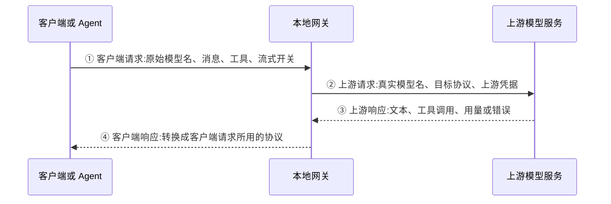

# model-gateway

用 TypeScript + Bun 从零实现一个本地 LLM 网关(模型转换器),目标是对标 Magpie 的核心层:协议翻译 + 路由。

## 第一步:目的

写代码之前,先把三件事写清楚:要解决什么问题、边界在哪、怎么算成功。

### 要解决的问题

不同的 Agent 和不同的模型厂商讲不同的"方言":

- Agent 期望 OpenAI Chat Completions / Anthropic Messages / Gemini 等格式
- 每个厂商又有自己的请求结构、流式事件、工具调用和思考(reasoning)表达方式

直接对接意味着 Agent × 厂商 的组合爆炸,密钥散落各处,换模型要改代码。

### 目标(一句话)

做一个本地网关:统一入口收下 OpenAI 格式的请求,内部翻译成统一中间格式(canonical),再翻译成目标厂商格式发出;把厂商的流式响应翻译回 OpenAI 格式返回。

### 第一版边界(不做什么)

- 不做 GUI / 菜单栏,只做 HTTP 网关
- 不做隐私脱敏、额度监控、多账号轮换(那是 Magpie 的加分项,后面再学)
- 先支持 OpenAI(直通),再依次加 Anthropic、Gemini

### 验收标准

- `bun run dev` 能起服务
- `curl http://127.0.0.1:3425/v1/models` 列出模型
- `curl -N` 发起 `/v1/chat/completions` 能流式收到 OpenAI 格式回复
- 同一个请求换 Anthropic 后端,返回格式不变(第 4 步达成)

### 学习目标(比代码更重要)

吃透一份"模型调用契约":messages 的角色与内容块、tools 的 schema、流式 SSE 事件、reasoning 的表达。这是理解 Agent 的地基。

## 骨架

```text
gateway/
├── package.json
├── tsconfig.json
├── src/
│   ├── main.ts            # Bun.serve 入口 + 路由
│   ├── types.ts           # 统一中间格式(canonical)
│   ├── config.ts          # 配置与密钥(环境变量)
│   ├── router.ts          # model -> provider 路由
│   ├── providers/
│   │   ├── base.ts        # Provider 抽象接口
│   │   └── openai.ts      # OpenAI 直通(骨架参考实现)
│   └── translate/
│       ├── sse.ts         # SSE 字节流解析
│       ├── fromOpenai.ts  # 原始 OpenAI 请求 -> canonical
│       └── toOpenai.ts    # canonical -> OpenAI 流 / JSON 响应
└── README.md
```

核心约定:所有 Provider 都吃 `ChatRequest`、吐 `StreamEvent` 流;加一个厂商 = 写两个翻译函数 + 一个 Provider 类。

## 对照真实项目:入口、出口和 Provider

本节用于建立整体认识,对照的是 [CC Switch](https://github.com/farion1231/cc-switch) 和 [Magpie](https://github.com/yetone/magpie)。公开文档与源码核对日期:2026-11-05。下文的流程图是职责示意,具体字段和调用路径会随版本变化。

### 1. 一次调用有四段,先分清“出口”指哪一段



从网络方向说,“出口”经常指第 ② 段:网关向厂商发送请求。从我们代码里的“响应出”说,“出口”指第 ④ 段:把厂商结果返回给客户端。读代码时要明确是哪一段。

| 位置 | 主要包含什么 | 当前 gateway 对应位置 |
|---|---|---|
| ① 客户端入口 | HTTP 路径、请求头、JSON 正文;正文有模型、消息、工具、生成参数等 | `main.ts` 接收请求,`fromOpenai.ts` 转换正文 |
| ② 请求上游的出口 | 厂商地址、认证头、真实模型名、厂商要求的 JSON | `providers/openai.ts` 的 `toOpenAIBody()` 和 `fetch()` |
| ③ 上游响应入口 | HTTP 状态码、响应头、完整 JSON 或 SSE 字节流 | `providers/openai.ts` 的 `nonStream()` / `stream()` |
| ④ 返回客户端的出口 | 客户端协议要求的响应对象、流事件、结束原因和错误 | `toOpenai.ts` 的 `toOpenAIJSON()` / `toOpenAIStream()` |

### 2. 真实网关的入口通常支持多种协议

协议决定了请求和响应的结构,供应商决定了请求发到哪里。同一家供应商可以支持多种协议,多家供应商也可以使用同一种兼容协议。

下面是 Magpie 官方集成文档列出的主要入口,只列帮助理解的核心字段,不是完整 API 规范:

| 客户端协议 | 请求入口 | 请求结构的辨认线索 | 返回客户端的结构 |
|---|---|---|---|
| OpenAI Chat Completions | `POST /v1/chat/completions` | `model`、`messages`、`tools`、`stream` | 完整回复使用 `choices[].message`;流式使用 `choices[].delta` |
| OpenAI Responses | `POST /v1/responses` | `model`、`input`、`instructions`、`tools` | 完整回复使用 `output`;流式有 `response.*` 类型的事件 |
| Anthropic Messages | `POST /v1/messages` | `model`、独立的 `system`、`messages`、`max_tokens` | 完整回复使用 `content` 内容块;流式有 `message_start`、`content_block_delta` 等事件 |
| Gemini 原生协议 | `POST /v1beta/models/{model}:generateContent` 或 `:streamGenerateContent` | 模型名在路径中,正文有 `contents`、`parts`、`generationConfig` | 回复主要在 `candidates[].content.parts` 中 |

`GET /v1/models` 是模型目录接口,不发起聊天。Chat Completions 与 Responses 是两套不同的数据契约,不能只改请求路径就当作完成转换。

**客户端使用什么协议,网关就要按该协议返回。** 例如客户端发送 Anthropic Messages 请求,上游只支持 Chat Completions,网关需要同时转换请求和响应,客户端最终仍收到 Anthropic 结构。

入口列表来源:[Magpie 集成文档](https://github.com/yetone/magpie/blob/main/docs/integrating.md)。协议结构可以对照其 [Chat 实现](https://github.com/yetone/magpie/blob/main/internal/gateway/chat.go)、[Anthropic 实现](https://github.com/yetone/magpie/blob/main/internal/gateway/anthropic.go) 和同目录的其他协议实现。

### 3. CC Switch:既能管理配置,也能代理请求

CC Switch 有两条需要分开理解的路径:

- **直连模式:** 用户在界面中切换 Provider,程序把地址、密钥和模型等配置写进客户端的配置文件;实际请求由客户端直接发给上游。
- **本地路由模式:** 客户端地址指向 CC Switch 的本地 HTTP 服务;服务选择 Provider、注入真实凭据,按需转换协议,处理响应和故障转移。

因此,CC Switch 的 React 界面和 Tauri 命令负责管理配置;模型 API 请求通过本地代理服务处理。不能把界面的“切换供应商”操作当作聊天请求入口。

阅读源码时可以按下面的职责地图找文件;它不是所有请求都严格经过的单一调用顺序:

| 文件或模块,相对于 `src-tauri/src/` | 负责的事情 | 本项目中相近的位置 |
|---|---|---|
| `provider.rs` | 保存 Provider 配置和元数据 | `config.ts` 的配置类型 |
| `proxy/server.rs`、`proxy/handlers.rs` | 注册 HTTP 路由,接收和处理不同客户端协议的请求 | `main.ts` |
| `proxy/handler_context.rs`、`proxy/provider_router.rs` | 请求上下文、供应商选择等 | `router.ts`,但当前功能更少 |
| `proxy/forwarder.rs` | 组织上游请求和转发流程 | `OpenAIProvider.chat()` 中的上游调用 |
| `proxy/providers/adapter.rs`、`transform*.rs` | 地址、认证和协议转换 | `providers/openai.ts` 与 `translate/` 的部分职责 |
| `proxy/providers/streaming*.rs`、`proxy/response_processor.rs` | 流式转换、响应处理和用量等 | `stream()`、`sse.ts`、`toOpenai.ts` |

它的 `ProviderAdapter` 接口包含 `extract_base_url`、`extract_auth`、`build_url`、`get_auth_headers`、`needs_transform`、`transform_request` 和 `transform_response` 等方法。可以看出,真实适配器除了转换 JSON,还要处理地址和认证;流式转换还需要专门的实现。

来源:[CC Switch 架构说明](https://github.com/farion1231/cc-switch/blob/main/CONTRIBUTING.md#architecture)、[本地路由说明](https://github.com/farion1231/cc-switch/blob/main/docs/user-manual/en/4-proxy/4.1-service.md)、[代理源码目录](https://github.com/farion1231/cc-switch/tree/main/src-tauri/src/proxy)、[ProviderAdapter 接口](https://github.com/farion1231/cc-switch/blob/main/src-tauri/src/proxy/providers/adapter.rs)。

### 4. Magpie:多协议入口、路由和内部中间格式

Magpie 的网关支持上述多种入口,为每次调用确定供应商、模型、协议以及使用的密钥或账号。入口协议和上游协议匹配时可以透传;需要转换时走协议解析和重建流程。透传路径仍可能有认证、路由、用量记录等处理。

它确实定义了中间格式:在 `internal/gateway/ir.go` 中有 `Request`、`Message`、`Part`、`Event` 等类型。消息内容可以表示文本、图片、文件、工具调用、工具结果和 thinking 等信息。这个思路与本项目的 `ChatRequest`、`ContentPart`、`StreamEvent` 相近,实际表达的信息更多。

可以从这些位置入手:

| 位置 | 可以看到什么 |
|---|---|
| `internal/gateway/gateway.go` | `Handler()`、客户端路由、调用来源识别和请求处理主线 |
| `internal/gateway/ir.go` | 多种协议之间共用的内部请求、内容块和事件类型 |
| `internal/gateway/chat.go`、`anthropic.go` 等 | 各协议的解析、请求构建与响应处理 |
| `internal/provider/` | 供应商配置、密钥、账号及模型等管理 |
| 路由与账号子系统文档 | 如何选择候选上游、分配账号和进行 fallback |

它还可以使用订阅账号和插件提供的账号,所以接入一个上游不一定等于填写一个 API Key。账号认证、刷新与可用额度等也需要相应模块管理。

来源:[网关源码](https://github.com/yetone/magpie/blob/main/internal/gateway/gateway.go)、[中间格式源码](https://github.com/yetone/magpie/blob/main/internal/gateway/ir.go)、[路由与 fallback 说明](https://github.com/yetone/magpie/blob/main/docs/subsystems/gateway-routing.md)、[供应商与账号说明](https://github.com/yetone/magpie/blob/main/docs/subsystems/providers-accounts.md)。

### 5. Provider 到底包含什么

在真实项目里,Provider 这个词至少有两个层面的含义:

**Provider 配置:** 描述“接哪一家服务,用什么地址、凭据和模型”。它是数据,用于保存、展示和选择。

**Provider 适配实现:** 描述“如何与这家服务或这类协议通信”。它是代码,负责组装请求、认证、发送和解析响应。同一种适配实现可以被多个不同地址、不同密钥的 Provider 配置复用。

| 类别 | 常见内容 | 通常由谁使用 |
|---|---|---|
| 身份与展示 | `id`、名称、图标、备注 | 配置管理和界面 |
| 接口与协议 | 基础地址、支持的协议、端点路径、自定义请求头、网络代理 | 协议适配器和 HTTP 客户端 |
| 认证与账号 | API Key、OAuth 账号、令牌刷新、多组凭据 | 认证与账号管理模块 |
| 模型与能力 | 模型列表、别名、上下文窗口、是否支持图片、工具和 reasoning | 模型目录、路由和协议转换 |
| 调用实现 | 构建请求、发送 HTTP、解析 JSON/SSE、转换内部事件 | Provider 适配代码 |
| 调度与可用性 | 超时、重试、并发限制、账号选择、熔断、fallback | 通常由共享路由和执行模块协调 |
| 用量与运行状态 | token 用量、费用、剩余额度、错误和延迟 | 统计、监控和路由模块 |

这张表是常见职责的归纳,不是说两个项目都使用这些字段名,也不是要求把所有逻辑写进一个 Provider 类。配置可以保存调度选项,但路由器才负责执行选择策略。

真实数据结构的例子:

- CC Switch 的 `Provider` 包含 `id`、`name`、`settingsConfig`、`meta`、`inFailoverQueue` 等字段。地址、密钥等需要从相应客户端格式的配置里提取。
- Magpie 的 `Provider` 可以分别保存 Chat、Responses、Anthropic、Gemini 的地址,还有 Key/Keys、模型、Routing、Fallback、Affinity 等配置。同一家服务不一定只有一个通用 `baseUrl`。

来源:[CC Switch Provider 定义](https://github.com/farion1231/cc-switch/blob/main/src-tauri/src/provider.rs)、[Magpie Provider 定义](https://github.com/yetone/magpie/blob/main/internal/provider/provider.go)。

### 6. 补充两个具体来源:DeepSeek 和 ChatGPT / OpenAI

先分清四个概念:DeepSeek、OpenAI 是供应商;`deepseek-flash`、`chat-latest` 是具体 API 模型名;Chat Completions、Responses 是协议;ChatGPT 是产品及其账号体系。不能把这几种名称都当作 Provider 类型。

下面的 DeepSeek 和 OpenAI API 示例统一选择 Chat Completions,便于对照当前骨架;不表示它们只支持这一种协议。模型名按 2026-11-05 官方文档核对,实际可用范围以账号权限和服务端模型目录为准。

| 接入来源 | 上游地址或连接方式 | 凭据 | 模型例子 | Provider 需要做什么 |
|---|---|---|---|---|
| DeepSeek API | 基础地址 `https://api.deepseek.com`,聊天路径 `/chat/completions` | DeepSeek API Key | `deepseek-flash`、`deepseek-v4-pro` | 发送兼容格式请求,解析文本、工具调用、reasoning 和用量 |
| OpenAI API,包括 API 提供的 ChatGPT 模型 | 基础地址 `https://api.openai.com/v1`,聊天路径 `/chat/completions` | OpenAI API Key | `chat-latest`;前文的 `gpt-4o-mini` 用作已有骨架示例 | 使用 OpenAI API 的模型名、参数和认证,按目标协议读取结果 |
| ChatGPT 订阅账号通道,例如真实网关接入的 Codex 登录账号 | 由网关相应的订阅账号适配模块连接 | 登录产生的账号凭据,与 API Key 通道分开管理 | 使用该账号通道实际提供的模型目录 | 管理登录状态、令牌刷新、账号可用性和该通道的请求/响应 |

`chat-latest` 是 OpenAI API 中指向 ChatGPT 当前 Instant 模型的别名,底层版本会更新;调用它依然使用 API 凭据,不会因此变成“通过 ChatGPT 网页发消息”。前文保留的 `gpt-4o-mini` 当前已被官方标记为弃用,这里只沿用它讲解数据流,不把它当作当前推荐模型。

来源:[DeepSeek 首次 API 调用](https://api-docs.deepseek.com/)、[DeepSeek 模型目录](https://api-docs.deepseek.com/quick_start/pricing/)、[OpenAI Chat Latest](https://developers.openai.com/api/docs/models/chat-latest)、[OpenAI GPT-4o Mini](https://developers.openai.com/api/docs/models/gpt-4o-mini)、[Magpie 供应商与账号](https://github.com/yetone/magpie/blob/main/docs/subsystems/providers-accounts.md)。

#### DeepSeek:供应商不同,仍可复用同一类协议适配器

如果以后把配置和适配器解耦,可以形成这样的路由;这里的 `deepseek` Provider 尚未在当前代码中注册:

```text
客户端: POST /v1/chat/completions
        model = "deepseek/deepseek-flash"
                 ↓
路由:   providerId = "deepseek"
        upstreamModel = "deepseek-flash"
                 ↓
上游:   POST https://api.deepseek.com/chat/completions
        Authorization: Bearer <DeepSeek API Key>
        {"model":"deepseek-flash","messages":[{"role":"user","content":"你好"}],"stream":true}
                 ↓
返回:   上游文本增量 → 内部 text_delta → 客户端 choices[].delta.content
```

因为它支持 OpenAI 兼容格式,可以复用通用的 Chat Completions 适配代码,再补 DeepSeek 特有字段。思考模式使用 `thinking` 和 `reasoning_effort` 等参数,回复中的 `reasoning_content` 与最终回答 `content` 是不同字段,完整适配需要分别处理它们。

**当前骨架的实际情况:** `OpenAIProvider.id` 写死为 `openai`,启动代码也只注册这个 id。如果只把 `OPENAI_BASE_URL` 改成 `https://api.deepseek.com`,并把 `OPENAI_API_KEY` 设为 DeepSeek Key,现有代码发出的就是 DeepSeek 请求,但网关里的供应商标识仍叫 `openai`。因此此时客户端要使用裸模型名 `deepseek-flash` 或 `openai/deepseek-flash`,直接使用 `deepseek/deepseek-flash` 会找不到 Provider。

这说明“能用某种协议调用”与“供应商命名和注册已经完善”是两件事。现有转换还会丢掉 `thinking`、`reasoning_effort` 和 `reasoning_content` 等字段,所以只能借此理解文本调用路径,尚未完整支持 DeepSeek 的思考及工具调用语义。其思考模式默认开启,当前代码不转发关闭开关,也不向客户端返回思考内容。

来源:[DeepSeek 兼容 API 与地址](https://api-docs.deepseek.com/)、[DeepSeek 思考模式字段](https://api-docs.deepseek.com/guides/thinking_mode/)。

#### ChatGPT / OpenAI:API 通道和订阅账号通道分别理解

对于当前骨架,可以按下面的 API 路径理解:

```text
客户端 model = "openai/chat-latest"
    → 路由得到 OpenAIProvider,upstreamModel = "chat-latest"
    → 使用 OPENAI_API_KEY 请求 OpenAI 的 /v1/chat/completions
    → 上游响应转成内部 StreamEvent
    → 返回 Chat Completions 格式,响应 model 保留 "openai/chat-latest"
```

这里使用的还是前文相同的 JSON/SSE 结构,变化的是供应商配置和模型名。对于支持 Responses 的模型,真实网关也可以选择 Responses 通道,但那需要相应的协议适配;当前骨架的上游请求路径固定为 Chat Completions。

如果说的是“用我已有的 ChatGPT 订阅账号”,则需要真实网关支持的订阅账号通道,例如 Magpie 文档中的 Codex 登录账号。那部分包含账号读取或登录、刷新和账号调度,不是把 `OPENAI_API_KEY` 换成订阅名称就能实现。API 凭据、API 模型目录和订阅登录应分开理解;部分订阅可以领取并关联 API 额度,仍需按 API 通道完成配置。

本节补充的是模型来源、协议与接入方式的说明。当前项目仍使用 `OPENAI_API_KEY` / `OPENAI_BASE_URL` 这组配置,尚未实现独立 DeepSeek Provider 注册或 ChatGPT 订阅账号登录。

来源:[OpenAI Chat Latest 模型说明](https://developers.openai.com/api/docs/models/chat-latest)、[ChatGPT 订阅的 API 额度说明](https://developers.openai.com/api/docs/guides/chatgpt-api-credits)、[Magpie 账号通道说明](https://github.com/yetone/magpie/blob/main/docs/subsystems/providers-accounts.md)。

### 7. 对照我们现在的代码,走一遍具体请求

假设已经配置好 OpenAI 凭据,客户端发来 `model: "openai/gpt-4o-mini"`、`stream: true`,消息是“你好”:

```text
① main.ts 收到 POST /v1/chat/completions
   requestedModel = "openai/gpt-4o-mini"             客户端原始名称

② router.resolve(requestedModel)
   provider = 一个 OpenAIProvider 对象              负责上游通信的实现
   upstreamModel = "gpt-4o-mini"                    发给上游的真实名称

③ fromOpenAI(raw, upstreamModel)
   chatReq = {
     model: "gpt-4o-mini",
     stream: true,
     messages: [{ role: "user", content: "你好" }]
   }                                               网关内部统一请求

④ provider.chat(chatReq) 被下游开始消费
   toOpenAIBody(chatReq) → OpenAI 请求正文
   fetch(baseUrl + "/chat/completions")             用上游密钥发送请求

⑤ 上游 SSE → readSSE() → provider.stream()
   { type: "text_delta", text: "你好" }             内部文本事件示意
   { type: "done", finishReason: "stop" }           内部结束事件示意

⑥ toOpenAIStream(events, requestedModel)
   内部 text_delta → choices[0].delta.content
   内部 done       → choices[0].finish_reason
   响应 model      → "openai/gpt-4o-mini"            对客户端仍使用原始名称
   最后写入 data: [DONE],关闭 HTTP 响应流
```

非流式请求也经过内部事件,但最终由 `toOpenAIJSON()` 汇总成一个响应对象。`provider.chat()` 返回异步生成器时还没有发起上游调用,消费它才会执行里面的请求代码。

当前项目把两层分别放在了两个地方:

```ts
// config.ts:供应商配置,描述连接所需的数据。
interface ProviderConfig {
  id: string;
  baseUrl: string;
  apiKey: string;
}

// providers/base.ts:供应商实现需要遵守的接口,描述提供的能力。
interface Provider {
  readonly id: string;
  listModels(): Promise<ModelInfo[]>;
  chat(req: ChatRequest): AsyncGenerator<StreamEvent>;
}
```

所以 `provider` 不是一个模型名,也不是 API Key,而是能调用供应商的对象。`provider.constructor.name` 只打印它的类名 `OpenAIProvider`,不会展示这个对象的全部字段。

### 8. 这份骨架距离真实网关还有什么

当前已实现 OpenAI Chat Completions 的文本请求和响应转换。虽然 `types.ts` 已定义图片、工具和 thinking 等类型,这些定义本身不代表端到端已经支持;当前非字符串消息内容还会在入口被替换为空数组,上游解析也主要读取文本。

后续可按顺序补齐:完整的消息与工具转换 → 第二种上游协议 → 第二种客户端入口 → 参数和错误处理 → 超时与取消 → 账号、重试与故障转移 → 用量与可观测性。

跨协议转换不能只对文本改字段名,还要处理内容块、工具调用 ID 与参数片段、工具结果、reasoning 状态、用量和结束语义。特别是流式响应已经向客户端输出后,不能简单换个模型从头生成并拼接上去;Magpie 的路由文档也把 fallback 与“尚未向客户端发出回复”的阶段联系起来,进一步的流中恢复需要专门设计。

## 运行

先装 Bun(需要网络):

```sh
curl -fsSL https://bun.sh/install | bash
```

然后:

```sh
cd gateway
bun install
OPENAI_API_KEY=sk-... bun run dev
```

测试:

```sh
curl http://127.0.0.1:3425/v1/models

curl -N http://127.0.0.1:3425/v1/chat/completions \
  -H 'content-type: application/json' \
  -d '{"model":"gpt-4o-mini","stream":true,"messages":[{"role":"user","content":"hi"}]}'
```

## 路线图

| 步骤 | 内容 | 状态 |
|---|---|---|
| 1 | 目的 | ✅ 本文件 |
| 2 | 骨架 + OpenAI 直通 | ✅ |
| 3 | Provider 接口 + 路由 + 模型别名 | ✅ 骨架,别名表待填 |
| 4 | Anthropic 格式转换 | ⬜ |
| 5 | Gemini 格式转换 | ⬜ |
| 6 | 流式 SSE 翻译层 | ✅ 骨架,工具调用待补 |
| 7 | 工具调用 + reasoning 双向 | ⬜ |
| 8 | 故障转移与重试 | ⬜ |
| 9 | 配置 / 密钥 / CLI | ✅ 环境变量版 |
| 10 | golden 测试 | ⬜ |
