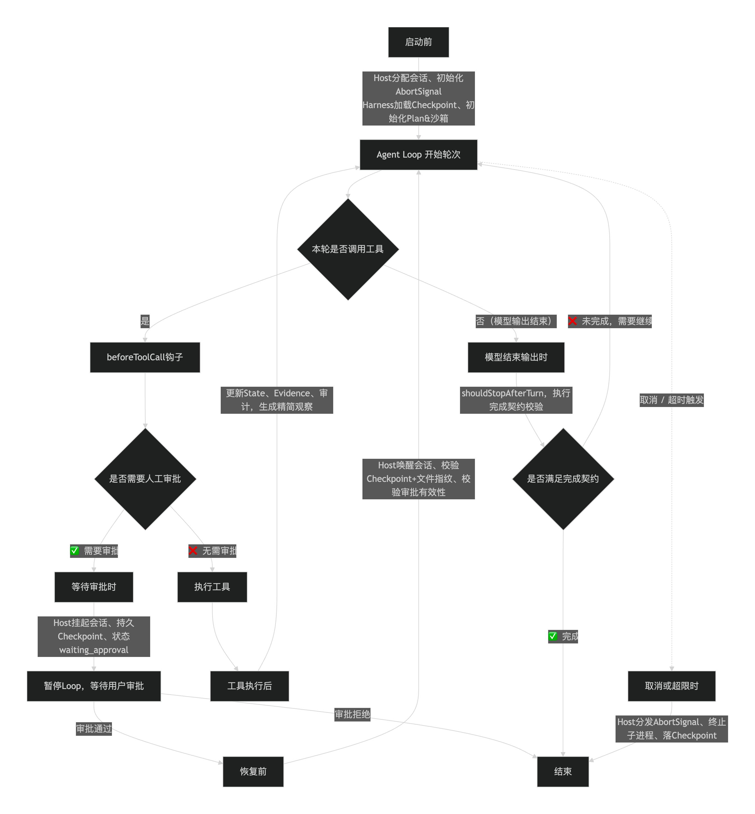

**Harness 核心概念与价值**

- **概念定义**
  - 词源与核心定义：Harness 原指马具，引申为 Agent 中组织工具、状态、上下文、执行环境的支撑程序集合。
  - Agent 组成公式：**Agent = Model + Harness**；Model 负责理解、推理与生成动作；Harness 负责让动作真正发生，组织模型调用、串联完整执行流程。
  - 
- **核心价值**
    - 效果差异原因：同一模型接入不同 Agent 效果不同，核心差异来自 Harness 对执行结果的组织方式。
    - 执行结果要求：需返回详细失败原因、错误码等信息，为模型下一轮动作提供参考，避免无效循环。
    - 重要认知：**Harness 不是单独写一个 “大类”，而是把已有模块按职责连接编排起来**。
- harness模块职责和运行逻辑
    - **模块分层与职责**
        - 组成模块清单：Agent Loop、Context、State / Checkpoint、Tool Runtime、Governance、Sandbox
        - 核心运行链路：`Model → Loop → Runtime → Tool / Sandbox → Result → Loop`
        - 运行层职责：Agent Runtime（任务运行层）负责更高层的启动、等待、取消、恢复、收尾；逻辑上整合在 Loop 中，不需要单独分层。
    - **状态与上下文区分**
        - Context（上下文）：给模型准备本轮对话信息，历史交互、目标、边界、验收标准，供给模型阅读。
        - State（状态）：保存程序需要核对的事实、计划、执行进度、验证证据、待办事项；Checkpoint 用于中断恢复。
    - 治理与沙箱：Governance 统一做权限、审批、参数校验；Sandbox 限制工具可访问的文件、进程、网络资源，隔离风险。

# 工程关键时机（Harness 在这些节点做编排）

| 时机 | 要组织的工作 | 为什么要在这里处理 | 责任模块（谁来做） | 执行方式（怎么做） | 备注（Host 调度介入情况） |
| ---- | ---- | ---- | ---- | ---- | ---- |
| 启动前 | 确认目标和完成要求；准备工作区、环境与工具；构建首轮上下文；加载 / 校验 Checkpoint；初始化计划；执行沙箱策略、权限校验 | 让模型从正确的现场和规则开始，避免带着脏状态、过期计划直接运行任务 | Agent Runtime (Host 调度) + Harness (Loop + Planning + Sandbox + Governance) | 1. Host：分配会话宿主实例，建立 AbortSignal 控制器； 2. Harness：读取任务配置，校验工作区真实文件版本； 3. Planning：初始化 Plan 与子步骤； 4. 组装首轮上下文（目标、入口、边界、验收标准）； 5. Sandbox 加载读写 / 网络策略； 6. Governance 做初始权限、凭证裁剪。 | ✅ Host 调度参与：会话实例分配、宿主进程初始化 |
| 工具执行后 | 回传工具原始结果；更新计划证据库；更新任务 State；提取审计记录；生成送给模型的精简观察；识别失败类型（环境失败 / 行为失败 / 结果不明） | 工具真实输出必须同时喂给模型推理，也要留给程序做业务校验；区分 “工具执行成功” 和 “业务目标达成” | Harness（Tool Runtime + Loop + Planning + 审计模块） | 1. Tool Runtime 拿到原始执行结果； 2. afterToolCall Hook：生成 Evidence 证据对象，绑定 planStepId； 3. 审计模块追加审计日志（成功 / 拒绝全部记录）； 4. 对输出做截断 / 摘要，保留引用，构造 ToolResult 送入消息流； 5. 更新任务状态；识别结果不明、待核查场景。 | ❌ Host 调度不参与，只负责信号传播，不处理业务证据与计划更新 |
| 等待审批时 | 保存完整待批动作（补丁 / 命令 + 当时工作区快照摘要）；终止当前 Loop 轮次；持久化 Checkpoint；拦截后续高风险写操作；把任务状态置为 waiting_approval | 不能边等待审批边继续执行写操作；批准后不能直接复用旧审批，如果现场文件已经变化则审批失效 | Agent Runtime (Host 调度) + Harness（State + Governance + LoopGuard） | 1. beforeToolCall 识别需要审批的动作，不再执行 handler； 2. 完整保存待批载荷、当前文件指纹、planStepId； 3. 写入 Checkpoint；任务状态切换 waiting_approval； 4. Loop 终止本轮运行，释放宿主执行资源； 5. Governance 持续拦截同类高风险操作。 | ✅ Host 调度参与：释放运行资源，会话进入挂起休眠 |
| 恢复前 | 校验 Checkpoint 完整性；核对真实工作区（文件指纹、未决动作）；校验旧审批是否仍然有效；还原 Plan、Evidence、预算计数；检查是否存在结果不明的写操作；再重建上下文 | 会话能恢复聊天记录≠业务任务可恢复；必须先核对现实现场，禁止直接重放写操作 | Agent Runtime (Host 调度) + Harness（Checkpoint + Planning + Sandbox） | 1. Host 调度拉起宿主会话进程，新建 AbortSignal； 2. 加载 Checkpoint 存档，校验格式与校验和； 3. 比对磁盘真实工作区与存档记录，识别结果不明操作； 4. 校验待批动作：文件 / 补丁发生变化则旧审批作废； 5. 还原计划、证据、轮次 / Token 预算； 6. 构建恢复后的上下文，再交给 Loop 继续运行。 | ✅ Host 调度参与：唤醒休眠会话、重建信号控制器 |
| 模型结束输出时 | 执行完成契约校验；检查证据版本有效性；识别缺失交付项；生成 follow‑up 消息；判断继续 / 停止；区分停止原因（完成 / 待用户 / 预算耗尽 / 取消） | 模型停止调用工具 ≠ 任务业务完成；不能把模型主观判断当成交付依据 | Harness（LoopGuard + CompletionContract + Planning） | 1. shouldStopAfterTurn Hook 触发完成契约校验； 2. 核对：Diff、测试证据 artifactVersion、交付产物； 3. 证据不足时生成 follow‑up 回传给模型继续执行； 4. 区分三类停止状态：完成 / 等待用户 / 主动停止； 5. 记录停止原因、已完成项、缺失项。 | ❌ Host 调度不参与业务完成判断，只接收最终停止信号 |
| 取消或超限时 | 传播 AbortSignal 到模型、工具、子进程；终止正在运行的 Shell / 子进程；保存停止原因；写 Checkpoint；区分 “已完成副作用” 和未执行动作；不会自动回滚已写入文件 | 界面停止输出不等于后台进程结束；中断不是回滚，已经产生的写副作用必须如实记录 | Agent Runtime (Host 调度) + Harness（Loop + Tool Runtime + Checkpoint） | 1. Host 调度触发 AbortSignal，沿整条链路向下传播； 2. Tool Runtime 终止子进程 / Shell，等待进程组退出； 3. 记录停止原因：aborted / maxTurns / timeout； 4. 轮次边界写入 Checkpoint，标记未决、结果不明动作； 5. 不自动回滚磁盘文件；输出可阅读停止摘要。 | ✅ Host 调度参与：信号分发、进程组终止 |

## harness和pi框架里面的host两者定位

表格

| 维度 | Harness（全集） | Host 调度（子集） |
| --- | --- | --- |
| 定义 | 围绕模型、把工具 / 状态 / 上下文 / 执行环境组织起来的整套支撑程序 | 承载并调度 Agent 会话的外层宿主进程 / 适配器 |
| 覆盖范围 | Loop、Context、State/Checkpoint、Tool Runtime、Governance、Sandbox，再加运行调度 | 只负责进程 / 会话的启动、等待、排队、唤醒、恢复、取消、并发与宿主接入 |
| 对应纪要模块 | 整个 Harness 架构 | 表里的 **Agent Runtime（任务运行层）** |
| Pi 里的对应物 | Pi Durable 整套：存储、会话管理、提交 / 等待、工具与钩子、状态持久化、环境选择等 8 组接口 | host adapter /durable-host daemon / Cloudflare Lifecycle：负责把会话挂在宿主上、evict 后唤醒、心跳与队列抖音CloudflareGitHub |

## 对应到你纪要里的时机

Host 调度主要出现在这几个节点：**启动前**拉起会话、**等待审批时**挂起排队、**恢复前**从 Checkpoint 唤醒、**取消 / 超限时**终止进程；而工具执行后更新状态、模型结束输出时做完成校验、上下文组装、沙箱隔离这些，都属于 Harness 但不属于 Host。

一句话记：**Harness = Model 之外的一切支撑程序；Host = 其中负责 "把 Agent 跑起来并挂住" 的调度外壳。** 说 "Host 是 Harness 的运行时宿主层" 成立，反过来画等号不成立。