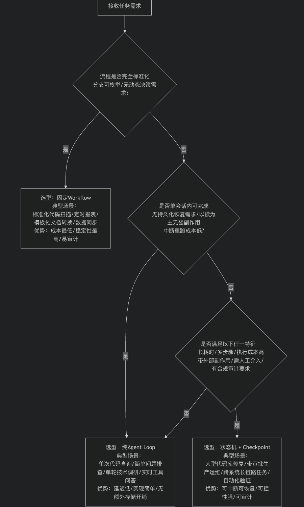

Agent 中断恢复需要基于：操作系统信号机制实现，全链路组件协同响应，且中断操作不自动回滚已执行的写入操作
业务层需要 任务状态机 步骤执行记录 检查点 三重机制补齐框架默认能力，实现可追溯，可断点续跑的任务执行流程

中断信号传递逻辑
-  发送中断信号而非强制杀进程
    - 中断基于操作系统abort singal实现
    - 信号沿着loop由外向内逐层传播
    - loop 模型，工具组件都需要响应信号
    - 信号下发后至下次执行前都无法取消

中断生效注意要点
- 中断不等于回滚，需要妥善收尾
    - 停止信号需要及时生效，避免工具执行完在停
    - 中断要妥善收尾，记录中止位置和错误信息
    - 业务层需保存现场，避免状态丢失


## 整体脉络
Agent在中断后，框架恢复了什么？没恢复什么，业务层要补什么，展开

**中断信号机制** 
Pi是协作式中止，’AbortSingle‘只是发出【停止请求】，但是pi不会自动回滚已经做完的操作（也就是已经发生的动作不会消失-- 这真是业务层checkpoint必须做对账的原因）
#### ① 触发：谁能叫停
- AbortSingle 可以由ctrl+c 手动触发，也可以业务代码调用‘abort(reason)’
- new AbortController() 的时候，支持 any()组合多个信号  timeout设置超时  wait等待信号

####  ② 传播：agent_loop 里的检查点（signal 贯穿全程）
就是 PPT 里写的这些地方，每一处都传入 `signal`：

- LLM 流式调用
- beforeToolCall 之后
- 工具执行前
- 相邻工具之间
- `execute(signal)` 工具执行

#### ③ 收口：中止不是抛异常，而是把消息链补完整
- 被中止的调用 标记为isError结果，提示Operation abort; 保证toolcall和toolResult配对不缺，形成闭环
    - 当调用工具的时候，被打断，pi就会补上一个toolResult。保证一定是成对闭合
- 助手消息： 打上stopReason: "aborted标记，
    ##### 为什么要这么设计收口
    1 为续跑服务：续接校验_assert_continuable（断言可继续）要求最后一条只能是user/toolresult.如果中断消息卡在toolcall,校验失败，无法run_agent_loop_continue
    2 消息日志自洽：所有日志回放，compaction,事件订阅都依赖合法消息链
    3 区分崩溃和主动中止  stopReason=aborted = 主动协作中止，消息链完整，可以对账，可以断点续跑

### 被打断，需要业务层关联什么
信息                        恢复时用来判断什么
1 计划与步骤进度：            哪些步骤已经完成，下一步准备做什么
2 工具执行记录和证据：         动作是否成功，测试结果是否完整可先
3 工作区标识和代码版本，摘要    现在的代码是否与保存时一致
4 待审批动作与人工决定          哪些动作人在等待确认，已有批准是否还适用

#### 恢复时触发校验
用户点【继续、续跑】-》业务层先读出这份checkpoint,然后按照下面的核对
1 核对计划进度 2 核对工具执行证据 3 核对工作区代码摘要 
4 核对待审批记录  
   -  ✅ 全部校验通过 → 再调用 Pi 的 `run_agent_loop_continue`
- ❌ 校验不通过（代码变了、审批失效）→ 拒绝续跑，抛出业务报错，不进入 Pi 底层续跑

### 续跑时，Pi实际恢复了什么？
Pi只恢复了  消息对话链的恢复 ，它不知道你代码改了什么，任务计划走到哪一步
整个流程分为两大阶段： 1持久化存储日志  2 重建合法上下文
#### ① 持久化：每条消息都是一次独立提交
1. Session 存储：JSONL 追加 /sqlite 串行事务

- **JSONL 追加**：JSONL 是一行一条 JSON。每产生一条消息（user /assistant/toolResult），就**追加写到文件末尾**，不修改旧行。好处：追加写几乎不会破坏历史日志，断电也不容易弄坏整条记录。
- **sqlite 串行事务**：用 sqlite 存会话日志，每次写入走串行事务，保证单条消息写入要么成功、要么完全不写，不会出现半条消息。
- 重点：**一条消息 = 一次独立提交**。
不是一轮结束批量保存，生成一条就落盘一条。中断的时候，已经生成的消息都已经写进日志里了，不会丢。
> 
> 存进去的东西叫 `entries`，就是一条条日志条目。

 2. 读取全部 entries，消息级提交日志
续接的时候，先把这个会话里所有日志条目全部读出来。
> 
> 不是实时内存里的，是从磁盘文件 /sqlite 读历史日志。

3. 定位最近 compaction，更早的 entries 整体丢弃
    compaction（压缩 / 截断）是什么？
    Agent 对话越来越长，全部塞给大模型会超上下文、token 很贵。
    Pi 会做**日志压缩**：把很早之前的一大段对话，提炼成一段摘要，然后**把压缩点之前原始的旧消息直接删掉**，只保留摘要 + 压缩点之后的消息。

    - 定位最近一次 compaction：找到日志里最近那个压缩标记点
    - 压缩点**更早的全部旧条目直接丢掉，不再回放**
    👉 所以：**不是全量回放历史对话，是截断之后只回放压缩点往后的内容**，这就是 `compaction 截断重放，不全量回放`。

持续化写入（每条消息独立提交）存在什么地方？
1 正常运行时（最主要）
 只要产生一条完整的消息，马上提交
    - 用户输入-》生成UserMessage->立刻写入session(JONSL/SQLite)
    - LLM输出完毕，生成AssistantMessage(带、不带toolcall)->立刻写入
    - 工具执行完毕，生成ToolResultMessage->立刻写入  
2 中断收口阶段（AbortSignal 触发）
    - 中断收口生成的那条**补出来的 aborted ToolResultMessage**，同样也要走这个持久化流程：
    - 框架补齐这条 toolResult、组装好助手消息标记 stopReason 之后，**照常写入日志**。   
3 compaction(上下文压缩)阶段
  compaction是后续的日志整理动作，不是写入
  读取已经持久化好的历史 entries，生成摘要，标记压缩点；之后丢弃压缩点之前原始消息，只保留摘要 + 后续消息。

总结：持久化日志用来有序保存每一条消息，一是为中断后重建对话上下文、支持断点续跑；二是支撑 compaction 压缩上下文；三是用于回放审计、故障排查；它只恢复对话状态，业务现场由 Checkpoint 单独保存
 
#### ② 重建：从存档回到合法上下文
 1. 投影回 AgentMessage，丢弃 error/aborted 助手
把读出来的原始 entries，转换成框架内部标准消息结构 `AgentMessage`。
同时过滤：**标记为 error、aborted 的助手消息直接扔掉**。
> 
> 注意：不是丢掉 aborted 对应的 toolResult！只是丢弃那条坏掉、中断的 assistant 消息，保证消息链干净。

 2. `_assert_continuable`：校验，最后一条必须是 user 或 toolResult
这是硬性校验规则，非常关键：
✅ 合法结尾（可以续跑）：
- 最后一条 = 用户消息 UserMessage
- 最后一条 = 工具返回结果 ToolResultMessage
❌ 非法结尾（**不能续跑**）：
- 最后一条是助手消息 AssistantMessage（比如助手刚发了 toolCall，还没拿到工具结果，就断了）

> 
> 这就是为什么中断收口的时候，必须补一条 toolResult：就是为了不让消息链停在助手消息上，保证这条校验通过。

这个函数就是做断言校验，不通过直接拒绝续跑。

 3. `run_agent_loop_continue`：带着重建好的合法上下文，进入下一轮 Agent 循环

校验通过之后，把整理好、过滤好、截断后的合法消息链交给 Agent loop，接着跑。
**Pi恢复的是对话状态，是有序，自洽的消息序列，保证LLM拿到之后可以继续对话，继续调用工具，只还原对话上下文，不还原外部环境和业务进度**  
✅ Pi 负责恢复（对话状态）
- 消息顺序
- 消息内容
- 消息类型（user /assistant/toolResult）
- 中止标记 `stopReason`
- 工具调用配对关系（toolCall ↔ toolResult）
- compaction 之后保留的上下文摘要  
恢复后知道
    - 用户之前提了什么需求
    - 大模型之前输出了什么文本、想要调用哪个工具、参数是什么
    - 之前工具调用成功 / 失败，返回了什么结果
    - 当前消息链停在哪一条，能不能继续（`_assert_continuable` 校验）
    > 
    > 也就是：**大模型拿到这串消息，能接着往下对话、继续调度工具**。
### 消息侧

在Pi的Agent消息链中，有
助手消息=大模型输出消息 、用户消息、  工具结果消息并列
消息一共三类核心条目：

1. `UserMessage`：用户发的提问、指令（人 → Agent）
2. `AssistantMessage`（助手消息）：大模型输出内容（Agent → 人 / 工具）
   - 里面可以是纯文本回答
   - 也可以携带 `toolCall`：告诉框架接下来要调用哪个工具、传什么参数
   - 中断的时候，会带上 `stopReason: "aborted"` 标记
3. `ToolResultMessage`：工具执行完返回的结果（工具 → Agent）

### 状态机
> 状态描述当前情况，迁移规则约束下一步

- `created`：任务创建，未启动
- `planning`：做方案规划
- `running`：Agent 思考、决策下一步
- `waiting_tool`：发出工具调用，阻塞等返回（异步）
- `tool_failed`：工具调用失败，进入失败分支判断
- `waiting_approval`：等待人工审批（Human-in-the-loop）
- `completed`：全部做完 + 验证通过，正常结束
- `failed`：任务不可恢复失败，终止
- `cancelled`：用户主动取消
### 步骤执行记录  
> 做过什么，结果与证据是什么

记录内容 7个
- 步骤与步骤进度
> 这次操作在完成哪一步，这一步做完了吗
- 工具名称，参数，调用id
> 具体调用了什么，操作的流水号是什么
- 工具输出
> 实际返回什么结果
- 失败原因
> 为什么没成功，还是根本没有拿到完整结果
- 重试与后续尝试
> 已经尝试过几次，每次做什么调整
- 下一步决策
> 接下来准备怎么处理
- 完成证据
> 凭什么说已经完成

###  业务checkpoint 
> 任务存档，为恢复提供证据
**保存信息为：**
| 存档保存信息 | 恢复时的作用 |
| ---- | ---- |
| 任务元数据（任务唯一 ID、用户原始指令、全局配置：模型 / 工具权限、最大轮次、预算） | 恢复的是哪个任务？原本要做什么？总约束是什么 |
| 状态快照（当前状态节点、进入时间、流转次数、中断原因、异常栈、是否可重试标记） | 当前停在哪个阶段、能不能重试、为什么停下 |
| 计划进度（子目标列表、每个子目标完成状态、依赖满足情况、已消耗 token / 时间预算） | 哪些做完了、还有哪些步骤、资源配额还剩多少 |
| 执行上下文快照（对话历史、所有工具调用 + 返回结果、收集证据、推理进度） | 让模型接上之前的上下文，复用已有证据 |
| 幂等 & 审计数据（循环唯一标识、副作用操作幂等 ID、操作日志） | 防止恢复时重复执行副作用，用于审计追溯 |
| 工作区信息（代码版本、文件摘要） | 判断代码环境有没有变动，确认在哪份代码上继续 |
| 中断标记： 待审批动作、人工决策记录 | 还有哪些人工审批项、审批状态 |

checkpoint写入触发的时机
| 触发时机 | 说明 | 对应检查点类型 |
| ---- | ---- | ---- |
| Agent每一轮循环结束 | 一轮思考+工具调用闭环完成，保存本轮现场 | 步级检查点 |
| 子目标/阶段完成后 | 一个计划项全部做完，阶段跳转前存档 | 阶段级检查点 |
| 副作用操作执行前 | 写文件、提交代码、调用写接口前先落盘，防止重复执行 | 步级 |
| 进入人工审批等待 | 暂停任务、等待人类确认，保存完整现场 | 阶段级 |
| 收到中断信号（Abort） | 用户取消、系统中断，保存中断现场 | 兜底快照 |
| 资源临近预算上限 | token、轮次、时间快耗尽，提前存档 | 兜底快照 |
pi 框架的接入点：
>先记住 Pi 里的核心事件：`turn_start` / `turn_end`、`tool_before_invoke`、`tool_after_result`、`plan_milestone`、`session_abort`、`await_approval`
1 步级：turn_end (每一轮tun,对应agent循环一轮)
> turn_start ->llm思考流式输出-》解析tool_call->调用工具-》拿到结果-》turn_end
在turn_end写入步级checkpoint,保存整轮完整快照(对话，工具返回，状态机，token预算)
配套前置高危点：tool_before_invoke（副作用工具执行前，必须存checkpoint,幂等保护）

2 阶段级checkoint() 粗粒度
接入点：plan_milestone/完成verifyCompletion 校验后
Pi的plan-and-execute,每完成一个子目标，通过verify校验后，触发里程碑事件；
这里写阶段快照：保存计划进度，子目标状态，依赖，整体预算
不是每轮turn都写，而是阶段验收通过之后写入

3 其他强制兜底接入点
- 人工审批，立刻存档
- 外部中断，中断现场快照
- 预算钩子（token临近上限）提前落盘

解释：
**计划 & 步骤进度：是「顶层任务规划层」** —— 我打算要做哪些事、子目标的整体进度、依赖关系、预算消耗（偏 Planner / 调度层）
**执行上下文快照：是「每一轮推理执行层」** —— 每一步 LLM 思考、工具调用、返回结果、对话证据（偏 Agent Loop 单轮运行时）
| 项目 | 计划 & 步骤进度 | 执行上下文快照 |
| ---- | ---- | ---- |
| 核心对象 | 子目标、任务依赖、整体计划 | 对话、工具调用记录、推理过程、证据池 |
| 关注点 | 任务蓝图：哪些子目标完成 / 没完成、先后依赖 | 推理现场：模型刚才说了啥、调用了啥工具、拿到什么证据 |
| 用途 | 恢复后判断：下一步该调度哪个子任务，是否满足依赖、预算是否超限 | 恢复后给 LLM 喂输入：让模型知道刚才一轮思考和工具结果，继续推理 |
| 例子 | 子目标 1：读取代码；子目标 2：定位 bug；子目标 3：生成补丁；子目标 1 已完成 | 上一轮 prompt、调用read_file返回的代码文本、模型刚才的推理结论、收集到的报错证据 |

**举个直观例子**
比如修复代码 Agent：

1. 计划进度：`子目标【定位bug】未完成，依赖【读取代码】已完成，剩余token 3000`
2. 执行上下文：`已经读取了a.js，返回内容xxx，模型上一轮推理：怀疑是数组越界，准备调用grep搜索`

##### 工作区解释
| 项目 | 工作区信息 | 执行上下文快照 |
| ---- | ---- | ---- |
| 核心对象 | 外部文件环境元信息（代码版本、文件摘要、路径） | Agent 推理会话内数据（对话、工具返回、证据、推理记录） |
| 关注点 | 磁盘上真实文件有没有变、代码基线是哪一份 | Agent 本轮思考链路、工具调用的返回结果 |
| 用途 | 恢复时校验：环境是否被外部改动，要不要拒绝继续执行 | 恢复时喂给LLM，承接上一轮的推理 |
| 例子 | git commit hash、文件md5摘要、项目根目录 | read_file拿到的代码文本、模型思考、工具返回、对话记录 |
Agent 调用 `read_file("a.ts")`：
1. **工作区信息**：记录 `a.ts` 的 md5、当前 git 版本，用来校验：恢复断点后，这个文件有没有被人在外面改了；
2. **执行上下文**：保存 `read_file` 返回的 a.ts 源码文本，给模型看、用来推理。
##### 科普
**副作用操作**
会改变外部真实状态的操作：写文件，发请求，提交git,调用支付接口
只读工具（读文件，查询）是没有副作用
**幂等ID:**同一个操作，不管执行多少次，结果都一样
给每一个副作用操作分配唯一标识，同一个ID只允许成功执行一次
给副作用操作加幂等 ID，就是为了恢复任务时，就算重试，也不会重复执行已经成功的写文件、发消息这些操作，避免搞乱外部状态。
**循环唯一标识**： 
agent每一轮react循环的id,用来记录这一轮的推理+工具调用批次
**操作日志：**
记录谁，什么时候，做了什么 ，结果
幂等 & 审计数据，用来标记带副作用的操作，保证 Checkpoint 恢复重试时**不会重复执行写操作**；同时留存操作流水，用于审计、故障排查。只读工具调用不需要幂等保护。

#### 面试
##### 1）请说明在长程 Agent 中，引入**状态机（State Machine）** 相比原生的 Agent Loop 循环，核心的优势是什么？状态机通常需要定义哪些核心状态节点？

    引入状态机好处: 记录现在到哪里了，规定接下来能做什么,业务自己定义的
    1 状态显式化，更好治理：任务所处阶段有明确标识，便于做限流，风控，审计，监控
    2 天然支持中断和恢复： 状态持久化，进程崩溃，人工暂停后都能从对应节点开始续跑
    3 易于对接外部流程：可无缝接入人工审批，异步工具，外部回调等节点
##### 原生agent怎么接入状态机
    1 定义状态枚举：规定任务阶段(比如上面)
    2 状态持久化存储： 和上下文对话分开储存（task_id关联）包含：状态、证据，审计，预算，计数等
    3 每轮loop前置状态路由层（就是状态控制器）：状态控制器会订阅一些事件（loop生命周期），然后对照迁移规则，将任务切换到上面那些状态
    4 状态变更留审计日志，状态变更触发对应的钩子（回调，告警，人工通知）

    通用长程 Agent 的核心状态节点：

    - 初始化态：接收任务、加载配置、校验权限
    - 规划态：拆解子目标、生成执行计划
    - 推理执行态：模型决策下一步动作
    - 工具执行态：调用外部工具，等待返回结果
    - 验证态：校验子目标完成度，判断是否达标
    - 等待态：等待人工审核 / 外部回调，任务挂起
    - 完成态：任务达成，输出最终结果
    - 失败 / 终止态：任务异常、超时或主动终止
##### 2工程落地设计）生产环境中，Agent 的 Checkpoint 检查点机制需要持久化哪些核心数据？请说明你会选择哪些触发时机写入检查点，并解释步级检查点和阶段级检查点的适用场景差异。
    持久化数据： 1任务元数据 2 状态快照 3 计划进度 3 执行上下文快照 4 幂等ID和审计数据 5中断标记
    触发时机写入检查点：1 每轮Agent循环之后 2 子阶段完成 3副作用操作执行前 4中断的时候
    步级检查时每轮循环写  阶段检查是 完成子阶段才写

##### 3场景方案设计）如果一个代码修复 Agent 需要支持「人工审核代码变更后再继续执行测试」的 Human-in-the-Loop 流程，请结合状态机与 Checkpoint 说明完整的执行与中断恢复流程，以及如何避免恢复后重复执行已完成的步骤。
pi框架来说
pi框架基础：hook调度+turn循环+生命周期hook+state状态机+checkpoint扩展钩子
从代码修复的角度看，停的节点是，代码执行态code_edit
1总体来说是
awiat_approval钩子内部写入完整的checkpoint
存入内容：
1 任务元数据+状态机 2 执行上下文快照  3 幂等id和审计信息  4 计划进度。

2 任务挂起后，发送人工审核通知
pi host调度暂停agent loop.任务进入休眠等待

3触发恢复，人工回调、服务重启加载session
pi的session恢复逻辑，加载session_id->读取对应的checkpoint快照，恢复全部上下文，状态机，计划进度
恢复后第一步：幂等校验（pi业务层自己实现的）
读取状态元数据里step_id:edit_code的完成标记：
- 标记=success(代码修复已经完成)
  - 直接跳过代码修改逻辑，不重复执行，流转到读取人工审核结果
- 标记=pending/failed(上次修改异常中断，没做完)
    - 回退，重新进入code_edit状态，重新执行代码修改turn

4读取审核结果，pi状态机分支跳转
- 审核通过
    状态机：awaiting_approval->test_varify
    host继续调度agent,开启下一轮turn，执行测试

- 审核失败
    - 状态机：awaiting_approval->code_edit(回到代码修改态)
    Agent 把驳回意见加入本轮对话上下文，开启新一轮 Turn，迭代修改代码；
📌【重点补充】迭代修改完成后，再次走到 `turn_end + await_approval`，**重新生成一份新 Checkpoint、更新幂等标记**，再次挂起等待审核，形成闭环。

###### pi框架下怎么避免恢复后重复执行
- **状态机 + 步骤幂等 ID 绑定，不是靠上下文猜是否做完**
每个副作用步骤（edit_code）分配唯一幂等 stepId，状态元数据记录`stepId + 执行状态`；恢复时优先校验这个标记
- checkpoint 写入时机绑定pi的await_approval钩子，在这里落盘.

- **副作用工具本身前置保护（tool_before_invoke）**
哪怕状态标记漏了，每次调用写文件 / 修改代码工具前，在`tool_before_invoke`钩子校验幂等 ID；已经成功的幂等 ID 直接拦截，不调用底层工具

###### 区分状态机元数据里的 stepId和副作用工具本身前置幂等保护
```
 第一层：状态机元数据里的 stepId（主校验，恢复阶段用）
> 
> 一句话：**恢复任务的时候用，在 Agent 重启 / 从 Checkpoint 加载上来第一时间跑**

- 时机：加载 Checkpoint、恢复会话的瞬间（还没进入任何 turn、还没准备调用工具）
- 存的位置：任务状态元数据（和 Checkpoint 快照绑定，独立于对话上下文）
- 逻辑：读 `stepId:edit_code`，状态 = success → 直接跳过整个 edit_code 子目标，根本不会走到要调用写文件工具的环节
- 特点：**粗粒度、阶段级判断**，判断「这个大步骤要不要做」
- 例子：恢复进来一看，代码修改步骤标记已经完成，直接跳到读取审核结果，Agent 循环调度层面就不往代码修改分支走了

> 
> 类比：项目进度表写着【编码已完成】，项目经理一看，直接安排测试，压根不安排编码工作。

第二层：tool_before_invoke 里的幂等 ID 校验（兜底拦截，工具调用前夕）

> 
> 一句话：**流程本应跳过，但因为 bug、状态标记丢了、状态机逻辑出错，依然走到了要调用副作用工具这一步时，才触发的兜底**

- 时机：已经进入到工具调用分发环节，马上要执行写文件 / 修改代码
- 存的位置：工具调用侧的幂等记录（toolId + 执行结果）
- 逻辑：哪怕上层状态标记漏写、bug 导致状态标记没更新，只要这个 tool_call 对应的幂等 ID 已经成功执行过，直接拦截，不调用底层 shell/write_file
- 特点：**细粒度、单工具级防护，是最后一道闸门**
- 例子：状态机 bug，标记没写成功，恢复后又重新走到要调用 write_file；钩子一看这个 tool 幂等 ID 已经执行成功，直接拦截，防止重复写文件
```
幂等绑定对象
1. 只要是 Turn**中间**（tool_before_invoke /tool_after_result/before_llm_invoke）挂起：**本轮 Turn 没有闭环**，恢复后是继续走完这一轮，不是开启新 Turn；而 turn_end、plan_milestone 是本轮 / 本阶段已经闭环，断点稳定。
2. 不同节点的幂等标记绑定对象不一样：
   - tool_before_invoke：幂等 ID 绑定单个 tool_call
   - turn_end：绑定整个 turn
   - plan_milestone：绑定子目标 ID


##### 第 4 题（架构选型决策）
是否所有 Agent 任务都需要引入状态机 + Checkpoint 机制？请说明你判断的依据，并分别举例说明「适合固定工作流」「适合纯 Agent Loop」「必须上状态机 + Checkpoint」三类任务的典型特征。



##### 第 5 题（故障与异常处理）

Agent 执行到工具调用环节时进程意外崩溃，重启后从最近的 Checkpoint 恢复。如果该工具是带有外部副作用的写操作（比如提交代码、发送消息），如何保证恢复后不会重复执行、产生副作用？请说明你的设计思路。
用户提问：查北京天气，绘图并下载图片
    ↓
用户提问：查北京天气，绘图并下载图片
    ↓
【Turn 1｜LLM 第1轮】
    → 返回工具调用：[get_weather]
        → 准备调用只读工具
        → 前置写入Checkpoint：状态机快照，当前step状态=执行中，无幂等ID
        → 执行查询天气
            ✅ 成功：更新状态机当前step状态=completed，将新快照写回Checkpoint；天气结果写入上下文 → 进入Turn2
            ⚠️ 崩溃：重启加载Checkpoint，恢复状态机；只读工具直接重试查询
    ↓
【Turn 2｜LLM 第2轮（上下文带上天气数据）】
    → 返回工具调用：[draw_chart]
        → 准备调用副作用写工具
        → 前置写入Checkpoint：状态机快照，当前step状态=执行中，写入幂等ID-02
        → 执行绘图
            ✅ 成功：更新状态机当前step状态=completed，新快照写回Checkpoint；图片信息写入上下文 → 进入Turn3
            ⚠️ 崩溃：重启加载Checkpoint，恢复状态机，拿着幂等ID-02对账
                ├─ 外部查到图片已生成 → 更新状态机step状态=completed，写回Checkpoint，跳过执行
                ├─ 外部确认生成失败 → 携带同一个幂等ID重试绘图
                └─ 状态无法确认 → 人工介入，禁止自动重试
    ↓
【Turn 3｜LLM 第3轮（上下文带上图片）】
    → 返回工具调用：[save_image]
        → 准备调用副作用写工具
        → 前置写入Checkpoint：状态机快照，当前step状态=执行中，写入幂等ID-03
        → 执行保存图片到本地
            ✅ 成功：更新状态机当前step状态=completed，新快照写回Checkpoint；保存路径写入上下文 → 进入Turn4
            ⚠️ 崩溃：重启加载Checkpoint，恢复状态机，拿着幂等ID-03对账
                ├─ 本地文件已存在 → 更新状态机step状态=completed，写回Checkpoint，跳过执行
                ├─ 本地确认写入失败 → 携带同一个幂等ID重试保存
                └─ 状态无法确认 → 人工介入，禁止自动重试
    ↓
【Turn 4｜LLM 第4轮（全部工具结果回填）】
    → 不返回tool_call，输出自然语言总结
    ↓
任务结束，返回结果给用户

**使用幂等去查重：**
>调用 draw_chart 提交绘图时，幂等 ID 和绘图参数一起传给绘图服务；服务以幂等 ID 作为唯一索引持久化任务记录。崩溃恢复对账时，Agent 拿着幂等 ID 调用服务的查询接口，而不是用原始参数去匹配。参数负责业务计算，幂等 ID 负责唯一标识本次动作、对账、去重
- Checkpoint：为了**恢复任务**
- 审计日志：为了**事后排查事故、溯源攻击尝试**