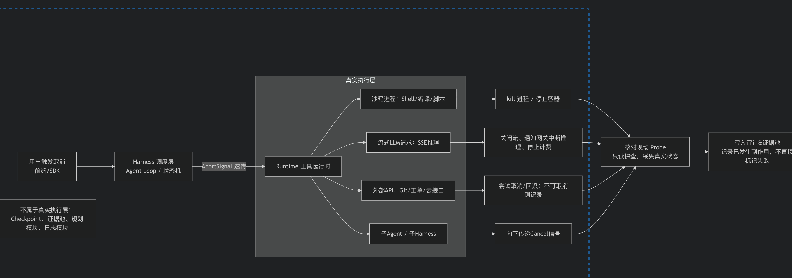
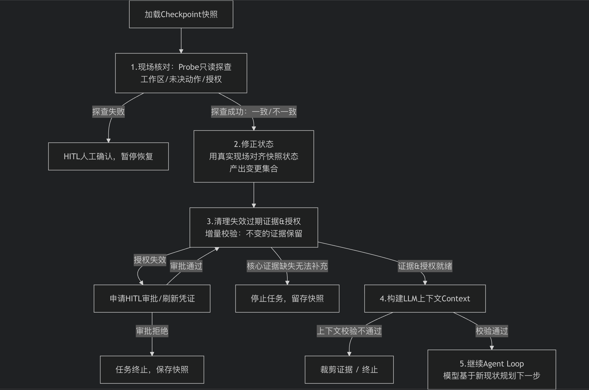

任务被打断。harnes处理异常路径的解决和处理
## 5类异常
- 1判断动作发生事实： 动作有没有发生
- 2结果不明：先核对现场
- 3用户取消：停止必须传到真实执行层
- 4再次恢复：会话重启恢复现场
- 5持续无进展：长任务语义层面的进度异常（活锁）
> 这是5类要处理的问题场景，不是串行的
> 1,2是单次工具动作中断时，事实溯源
#### 为什么这么设计
普通服务异常可以考错误码，但是agent harness有3个特殊的麻烦
- 工具调用带副作用，不能无脑重试
- 存在外部真实状态，本地快照不可信
- 有人工介入（取消，审批），长会话恢复，循环空转这些普通后端没有的控制流，所以不按429/500/超时，这种错误类型分，
而是按照中断之后要回答哪一个核心问题，分为5个阶段

### 举个例子
任务中断后，harness判断顺序  
1 优先检查：**有没有收到用户 Cancel 信号？**
- 有 → 【3 用户取消】：信号穿透到真实执行层，终止子任务 / 沙箱 / 模型流，记录已完成动作，不再继续；
- 无 → 往下走

2 提问：**动作到底有没有发生？（阶段 1：判断失败）**
这里得到 3 种结果：
- 情况 A：✅**确定动作已经成功执行**
→ 事实结论：动作完成。不需要重试。更新 Checkpoint、推进 Agent Loop，进入下一轮计划；
- 情况 B：❌**确定动作完全没有发生**
→ 事实结论：动作没落地。满足安全重试前提，进入有限重试策略（网关 / 工具层局部重试，受局部重试上限约束）；
- 情况 C：🤷**无法确定有没有执行（超时、断连、半写）**
→ 进入【2 结果不明：先核对现场】，去沙箱 / 文件 / 外部接口探查真实状态，核对完现场之后，再回到上面三态判断。

3 触发时机独立分支：**现在要从 Checkpoint 重启任务**（不是单次动作中断，是会话拉起）
→ 进入【4 再次恢复：重新检查旧状态和旧证据】
> 
> 区别于上面的 “核对现场”：核对现场 = 单次动作中断后查；恢复校验 = 隔一段时间重启，批量校验证据、权限、资源是否过期，校验通过才继续跑。

4 持续运行监控（全周期持续判断，不是单次中断才走）
→ 多轮循环、反复相同动作、没有新增证据、没有进度
→ 进入【5 持续无进展：主动停止】，停止任务，保留当前快照，防止空转死循环

#### 现场是什么
**现场 = 执行动作对应的外部真实资源状态**，  
> 恢复前需核查三类信息：**工作区域、未决动作、证据授权**
- 工作区域：文件沙箱资源
- 未决动作：in-flight pending 副作用
- 证据 + 授权：两条分开校验，证据看事实还真不真，授权看还能不能操作
查看agent中名词解释.md

#### 用户取消，必须传到真实执行层，
那么真实执行层是什么？怎么取消呢？
真实执行层：产生副作用的底层实体。

### checkpint 恢复顺序
Checkpoint 恢复一共五步：先对沙箱和外部资源做只读探查、核对现场；拿到真实情况修正快照里的状态；接着增量校验证据和授权，没变的有效证据保留，过期、关联变更的证据剔除；授权失效要重新走人工审批；之后用清洗好的状态、证据、权限组装上下文；最后交给 Agent Loop 继续执行。探查失败、审批拒绝、关键证据无法补全，都会走到任务暂停或者终止分支。

probe（探查器）是一类只读探查函数，是harness体系里专门用来查询外部真实状态，不带任何副作用的抽象能力
>getFileHash、queryGitStatus、checkApiResource、getSandboxProcessList